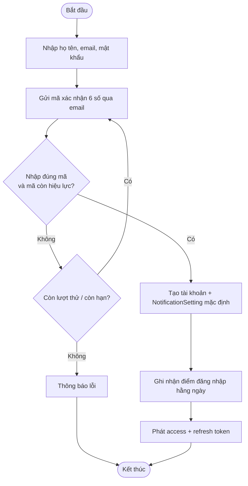
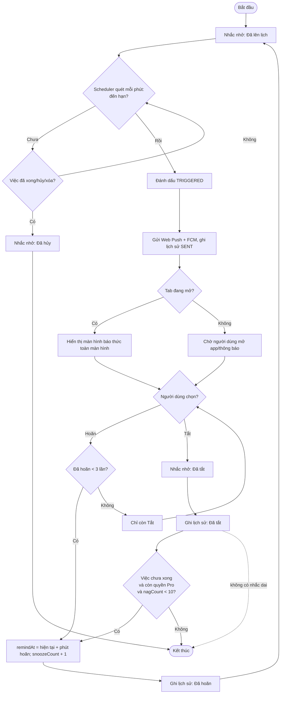
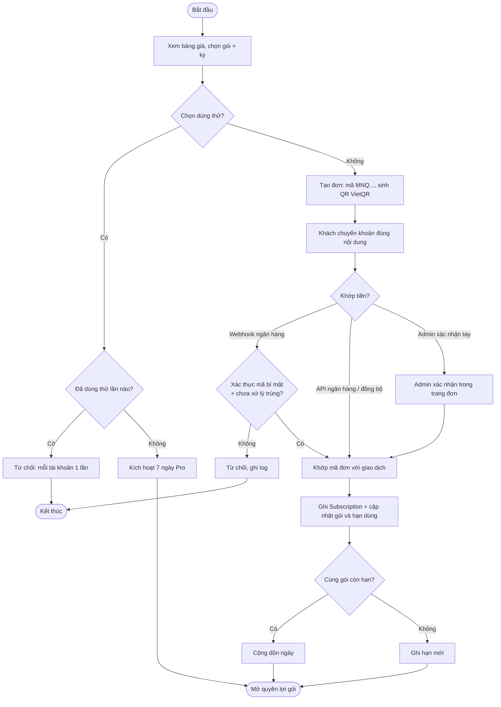
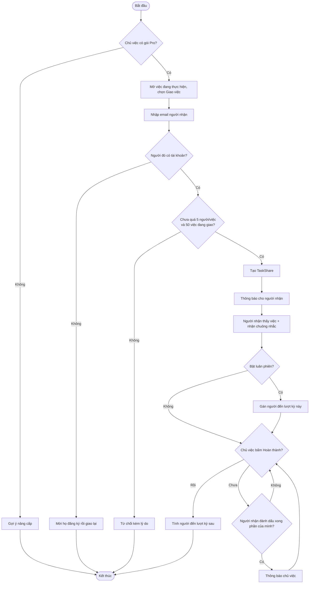
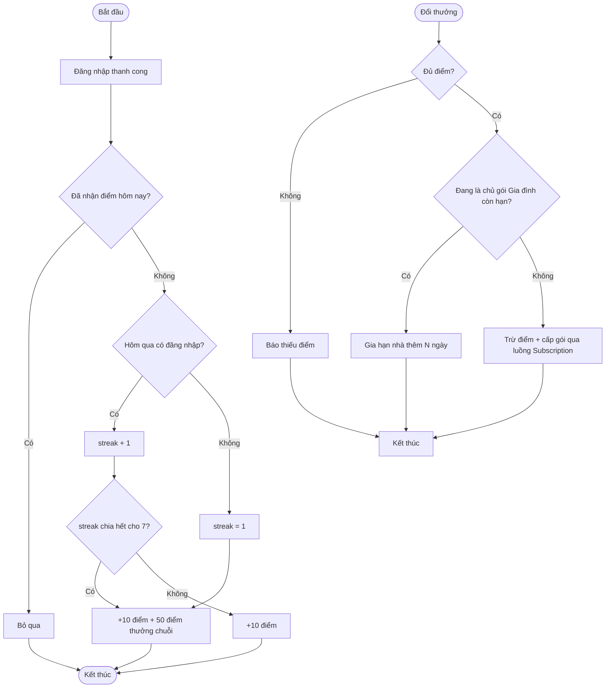

# Use Case Diagram và Activity Diagram – MN-Qronx

> Tài liệu này thay thế `02_TaskAlarm_Diagrams.md`. Sơ đồ phản ánh hệ thống đang chạy thật, bao gồm các module mới: gói & thanh toán, trợ lý AI, giao việc, gói gia đình, điểm thưởng, báo cáo/kế hoạch tuần và hỗ trợ.

## 1. Quy ước

- Actor: `Guest`, `User` (theo gói: Miễn phí/Plus/Pro/Pro Gia đình), `Admin`; và các **hệ thống ngoài**: Cổng thanh toán/ngân hàng, Dịch vụ email, Dịch vụ thông báo đẩy (Web Push/FCM), AI inference server.
- Trạng thái công việc lưu trong DB: **Chưa làm (`TODO`)**, **Đang làm (`IN_PROGRESS`)**, **Hoàn thành (`COMPLETED`)**, **Đã hủy (`CANCELLED`)**. "Quá hạn" chỉ là trạng thái hiển thị.
- Nhắc nhở hoạt động như báo thức: âm thanh/rung + màn hình toàn màn hình, Hoãn (tối đa 3 lần) hoặc Tắt. Gói Pro có thêm **nhắc dai**.
- Token xác thực: access token (JWT ngắn hạn) + refresh token (dài hạn, lưu DB).

## 2. Use Case Diagram

```mermaid
flowchart LR
    G[Guest]
    U[User]
    A[Admin]
    PAY[Cổng thanh toán / Ngân hàng]
    MAIL[Dịch vụ email]
    PUSH[Dịch vụ thông báo đẩy]
    AI[AI inference server]

    subgraph TA[Hệ thống MN-Qronx]
        direction TB

        subgraph Public[Chức năng công khai]
            UC01([Xem trang giới thiệu])
            UC02([Xem bảng giá])
            UC03([Gửi mã xác nhận email])
            UC04([Đăng ký])
            UC05([Đăng nhập / Google OAuth])
            UC06([Làm mới token])
            UC07([Quên / Đặt lại mật khẩu])
        end

        subgraph CoreUser[Chức năng User cốt lõi]
            UC10([Quản lý hồ sơ & mật khẩu])
            UC11([Quản lý danh mục])
            UC12([Quản lý công việc])
            UC13([Quản lý việc con])
            UC14([Thiết lập lặp lại])
            UC15([Thiết lập nhắc nhở])
            UC16([Nhận báo thức])
            UC17([Hoãn báo thức])
            UC18([Tắt báo thức])
            UC19([Cài đặt thông báo & âm thanh])
            UC20([Quản lý thiết bị & Web Push])
            UC21([Xem lịch sử thông báo])
            UC22([Tìm kiếm / lọc công việc])
            UC23([Xem lịch])
            UC24([Xuất lịch .ics])
            UC25([Xem dashboard cá nhân])
            UC26([Thùng rác & khôi phục])
        end

        subgraph PaidUser[Chức năng gói trả phí]
            UC30([Nhập việc bằng AI / giọng nói])
            UC31([Nhắc dai])
            UC32([Kế hoạch tuần])
            UC33([Báo cáo năng suất & xuất file])
            UC34([Giao việc cho người khác])
            UC35([Luân phiên người làm])
            UC36([Gói Pro Gia đình])
            UC37([Báo cáo tuần qua email])
        end

        subgraph Commerce[Gói & thanh toán]
            UC40([Xem gói hiện tại])
            UC41([Dùng thử Pro])
            UC42([Tạo đơn mua gói])
            UC43([Kiểm tra / Hủy đơn])
            UC44([Tích & đổi điểm thưởng])
            UC45([Mời bạn bè])
        end

        subgraph SupportMod[Chức năng hỗ trợ]
            UC50([Chat hỗ trợ])
            UC51([Trả lời hỗ trợ])
        end

        subgraph AdminFeature[Chức năng Admin]
            UC60([Xem dashboard hệ thống])
            UC61([Quản lý người dùng])
            UC62([Quản lý đơn hàng])
            UC63([Cấu hình nhận tiền & webhook])
        end

        subgraph SysOps[Use Case tự động của hệ thống]
            UC70([Kích hoạt báo thức (scheduler)])
            UC71([Ghi lịch sử thông báo])
            UC72([Sinh công việc lặp kế tiếp])
            UC73([Hủy nhắc nhở chưa kích hoạt])
            UC74([Hạ gói hết hạn & đồng bộ gói gia đình])
            UC75([Đồng bộ giao dịch ngân hàng])
            UC76([Gửi báo cáo tuần])
            UC77([Dọn thùng rác quá 30 ngày])
        end
    end

    G --- UC01
    G --- UC02
    G --- UC03
    G --- UC04
    G --- UC05
    G --- UC07

    U --- UC02
    U --- UC06
    U --- UC10
    U --- UC11
    U --- UC12
    U --- UC13
    U --- UC14
    U --- UC15
    U --- UC16
    U --- UC17
    U --- UC18
    U --- UC19
    U --- UC20
    U --- UC21
    U --- UC22
    U --- UC23
    U --- UC24
    U --- UC25
    U --- UC26
    U --- UC30
    U --- UC31
    U --- UC32
    U --- UC33
    U --- UC34
    U --- UC35
    U --- UC36
    U --- UC37
    U --- UC40
    U --- UC41
    U --- UC42
    U --- UC43
    U --- UC44
    U --- UC45
    U --- UC50

    A --- UC05
    A --- UC51
    A --- UC60
    A --- UC61
    A --- UC62
    A --- UC63

    UC04 -. "<<include>>" .-> UC03
    UC16 -. "<<include>>" .-> UC70
    UC16 -. "<<include>>" .-> UC71
    UC17 -. "<<include>>" .-> UC71
    UC18 -. "<<include>>" .-> UC71
    UC12 -. "<<include>>" .-> UC72
    UC12 -. "<<include>>" .-> UC73
    UC26 -. "<<include>>" .-> UC77
    UC36 -. "<<include>>" .-> UC74
    UC42 -. "<<include>>" .-> UC75
    UC37 -. "<<include>>" .-> UC76
    UC30 -. "<<include>>" .-> AI
    UC03 -. "<<include>>" .-> MAIL
    UC07 -. "<<include>>" .-> MAIL
    UC37 -. "<<include>>" .-> MAIL
    UC43 -. "<<include>>" .-> PAY
    UC63 -. "<<include>>" .-> PAY
    UC70 -. "<<include>>" .-> PUSH
```

### 2.1. Ghi chú Use Case

- `Đăng ký` bao gồm `Gửi mã xác nhận email`; tài khoản chỉ được tạo khi mã hợp lệ.
- `Nhận báo thức` bao gồm việc hệ thống tự kích hoạt báo thức đúng giờ (`UC70`) và ghi lịch sử (`UC71`); nếu việc bật nhắc dai và chưa xong, chuông kêu lại (tối đa 10 lần).
- `Hoãn` và `Tắt` đều ghi vào lịch sử thông báo.
- `Quản lý công việc` bao gồm tự sinh việc lặp kế tiếp (`UC72`) và hủy nhắc nhở chưa kích hoạt (`UC73`).
- `Thùng rác` bao gồm việc dọn tự động sau 30 ngày (`UC77`).
- `Tạo đơn mua gói` bao gồm đối soát với cổng thanh toán/ngân hàng; gói gia đình bao gồm đồng bộ quyền lợi thành viên (`UC74`).
- Các chức năng đánh dấu "trả phí" (`UC31`–`UC37`) yêu cầu gói Pro (hoặc Pro Gia đình); giao việc yêu cầu chủ việc có gói Pro nhưng **người nhận không cần trả phí**.

## 3. Activity Diagram – Đăng ký và xác thực email



## 4. Activity Diagram – Tạo công việc và thiết lập nhắc nhở

```mermaid
flowchart TD
    Start([Bắt đầu]) --> AuthCheck{Đã đăng nhập?}
    AuthCheck -- Không --> Login[Đăng nhập/Đăng ký] --> AuthCheck
    AuthCheck -- Có --> Form[Nhập tiêu đề, mô tả, danh mục, ưu tiên, thời hạn]
    Form --> Valid{Tiêu đề không rỗng<br/>và có thời hạn?}
    Valid -- Không --> Form
    Valid -- Có --> PlanLimit{Còn hạn mức việc theo gói?}
    PlanLimit -- Không --> Upgrade[Gợi ý nâng cấp] --> End([Kết thúc])
    PlanLimit -- Có --> Repeat{Chọn lặp lại?}
    Repeat -- WEEKLY --> PickDays[Chọn các thứ trong tuần]
    Repeat -- DAILY/MONTHLY/NONE --> Reminder
    PickDays --> Reminder[Thiết lập một hoặc nhiều nhắc nhở]
    Reminder --> RemValid{remindAt <= dueAt<br/>và số nhắc <= giới hạn gói?}
    RemValid -- Không --> Reminder
    RemValid -- Có --> Nag{Có bật nhắc dai?<br/>(chỉ Pro)}
    Nag -- Có --> NagValue[Chọn chu kỳ 1-30 phút]
    Nag -- Không --> Save
    NagValue --> Save[Lưu công việc + nhắc nhở + việc con]
    Save --> Schedule[Đưa reminder vào hàng đợi scheduler]
    Schedule --> Done([Thông báo tạo thành công])
```

## 5. Activity Diagram – Vòng đời báo thức (có nhắc dai)



### 5.1. Quy tắc chuyển trạng thái nhắc nhở

| Trạng thái hiện tại | Sự kiện | Trạng thái sau xử lý | Ghi chú |
|---|---|---|---|
| Đã lên lịch | Đến giờ nhắc | Đã kích hoạt | Gửi thông báo kèm âm thanh/rung; ghi log "Đã gửi". |
| Đã lên lịch | Việc Hoàn thành/Đã hủy/Xóa trước giờ | Đã hủy | Không gửi thông báo. |
| Đã kích hoạt | Hoãn (số lần hoãn < 3) | Đã lên lịch (mốc mới) | Ghi log "Đã hoãn". |
| Đã kích hoạt | Hoãn (đã đủ 3 lần) | Đã kích hoạt (giữ nguyên) | Không cho hoãn thêm, chỉ còn Tắt. |
| Đã kích hoạt | Tắt, việc chưa xong, còn Pro, nagCount < 10 | Đã lên lịch (mốc mới = +N phút) | Nhắc dai; tăng `nagCount`. |
| Đã kích hoạt | Tắt, hết trần nhắc dai / không Pro / việc đã xong | Đã tắt | Kết thúc vòng đời nhắc nhở. |

## 6. Activity Diagram – Mua gói và kích hoạt



## 7. Activity Diagram – Giao việc và luân phiên (gói Pro)



## 8. Activity Diagram – Điểm thưởng và đổi thưởng



## 9. Kiểm tra nhất quán với tài liệu BA

| Nội dung BA | Thể hiện trong sơ đồ |
|---|---|
| Xác thực email khi đăng ký | Activity Diagram mục 3. |
| Cơ chế báo thức (âm thanh/rung/toàn màn hình) | Use Case `UC16`–`UC18`; Activity Diagram mục 5. |
| Hoãn tối đa 3 lần | Nhánh `Count` trong Activity Diagram mục 5. |
| Nhắc dai (Pro, tối đa 10 lần) | Nhánh `NagCheck` trong Activity Diagram mục 5. |
| Hủy nhắc nhở khi việc kết thúc sớm | Nhánh `TaskEnded` trong Activity Diagram mục 5. |
| Sinh việc lặp kế tiếp | `UC72`; BR-16. |
| Thùng rác 30 ngày | `UC26`, `UC77`; BR-13, BR-14. |
| Thanh toán VietQR + webhook/API/admin | Activity Diagram mục 6. |
| Giao việc + luân phiên | Activity Diagram mục 7. |
| Điểm thưởng & đổi thưởng | Activity Diagram mục 8. |

### 9.1. Đối chiếu mã sơ đồ với Business Analysis

| Mã sơ đồ | Mã Use Case trong BA |
|---|---|
| `UC01`–`UC07` | `UC-G-01` đến `UC-G-05` (kèm làm mới token, gửi mã xác nhận). |
| `UC10`–`UC26` | `UC-U-01` đến `UC-U-24` (tách riêng thùng rác, xuất `.ics`). |
| `UC30`–`UC37` | `UC-U-24` đến `UC-U-33` (nhóm quyền lợi Pro). |
| `UC40`–`UC45` | `UC-U-31`, `UC-U-32`. |
| `UC50`, `UC51` | `UC-U-34`, `UC-A-06`. |
| `UC60`–`UC63` | `UC-A-02` đến `UC-A-05`. |
| `UC70`–`UC77` | Use Case tự động, không có mã độc lập trong BA. |
