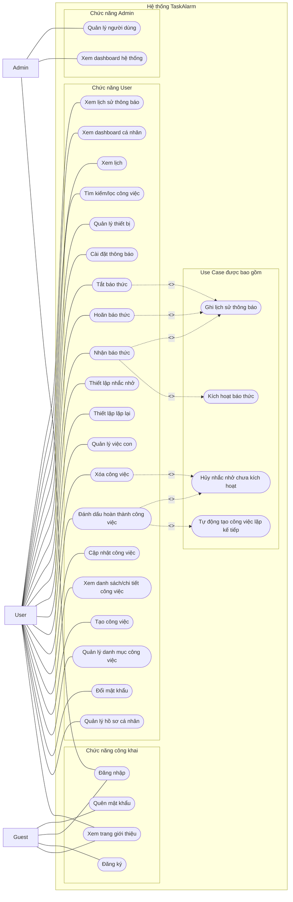
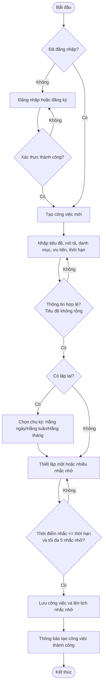
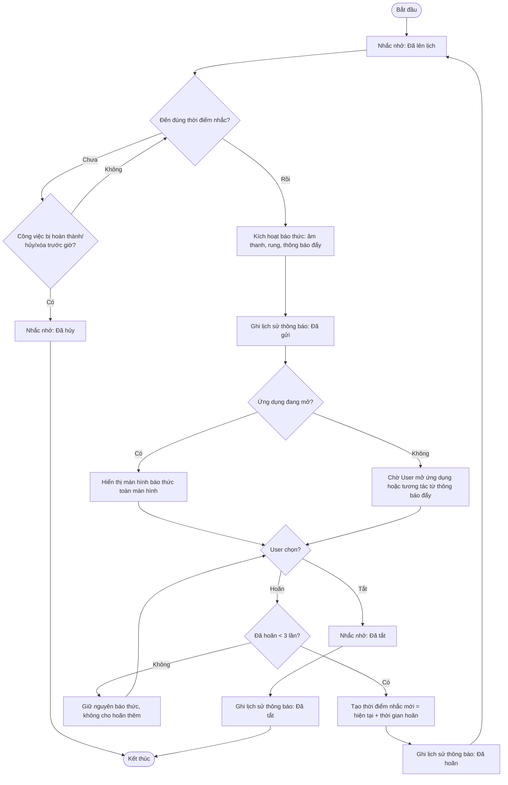

# Use Case Diagram và Activity Diagram – TaskAlarm

## 1. Quy ước

- Actor gồm: `Guest`, `User`, `Admin`.
- User có toàn bộ khả năng xem trang giới thiệu của Guest sau khi đăng nhập.
- Trạng thái công việc: **Chưa làm**, **Đang làm**, **Hoàn thành**, **Đã hủy**. "Quá hạn" là trạng thái hiển thị tính toán, không lưu riêng.
- Cơ chế nhắc nhở hoạt động như báo thức: kích hoạt kèm âm thanh/rung, cho phép Hoãn (tối đa 3 lần) hoặc Tắt.

## 2. Use Case Diagram

### 2.1. Ghi chú Use Case

- `Nhận báo thức` bao gồm việc hệ thống tự động kích hoạt báo thức đúng giờ và ghi lại vào lịch sử thông báo.
- `Hoãn báo thức` và `Tắt báo thức` đều được ghi vào lịch sử thông báo để User tra cứu lại.
- `Đánh dấu hoàn thành công việc` bao gồm việc tự động tạo công việc lặp kế tiếp (nếu công việc có lặp lại) và hủy các nhắc nhở chưa kích hoạt của công việc đó.
- `Xóa công việc` cũng kéo theo việc hủy toàn bộ nhắc nhở chưa kích hoạt liên quan.
- User chỉ hủy được nhắc nhở bằng cách hoàn thành, hủy hoặc xóa công việc chứa nhắc nhở đó, hoặc chỉnh sửa/xóa trực tiếp nhắc nhở khi công việc chưa đến giờ báo.

## 3. Activity Diagram – Quy trình tạo công việc và thiết lập nhắc nhở

### 3.1. Kết quả của quy trình tạo công việc

- Công việc mới được tạo với trạng thái **Chưa làm**.
- Mỗi nhắc nhở hợp lệ được đưa vào hàng đợi lên lịch để hệ thống kích hoạt đúng giờ.
- Nếu công việc có lặp lại, chu kỳ được lưu cùng công việc để tái sử dụng khi hoàn thành lần đầu.

## 4. Activity Diagram – Quy trình báo thức (Reminder Lifecycle)

### 4.1. Quy tắc chuyển trạng thái nhắc nhở

| Trạng thái hiện tại | Sự kiện | Trạng thái sau xử lý | Ghi chú |
|---|---|---|---|
| Đã lên lịch | Đến giờ nhắc | Đã kích hoạt | Gửi thông báo kèm âm thanh, rung; ghi log "Đã gửi". |
| Đã lên lịch | Công việc Hoàn thành/Đã hủy/Xóa trước giờ | Đã hủy | Không gửi thông báo. |
| Đã kích hoạt | User chọn Hoãn (số lần hoãn < 3) | Đã lên lịch (thời điểm mới) | Ghi log "Đã hoãn". |
| Đã kích hoạt | User chọn Hoãn (đã đủ 3 lần) | Đã kích hoạt (giữ nguyên) | Không cho hoãn thêm, chỉ có thể Tắt. |
| Đã kích hoạt | User chọn Tắt | Đã tắt | Ghi log "Đã tắt"; kết thúc vòng đời nhắc nhở. |

## 5. Kiểm tra nhất quán với tài liệu BA

| Nội dung | Thể hiện trong sơ đồ |
|---|---|
| Cơ chế báo thức | Kích hoạt kèm âm thanh/rung, không phải thông báo im lặng thông thường. |
| Giới hạn hoãn | Tối đa 3 lần hoãn liên tiếp trước khi bắt buộc Tắt. |
| Hủy nhắc nhở khi công việc kết thúc sớm | Thể hiện trong nhánh `TaskChanged` của Activity Diagram báo thức. |
| Công việc lặp lại | Chu kỳ được chọn ngay khi tạo công việc, tái sử dụng khi hoàn thành. |
| Ghi log thông báo | Mọi nhánh Gửi/Hoãn/Tắt đều có bước ghi lịch sử thông báo tương ứng. |

### 5.1. Đối chiếu mã sơ đồ với Business Analysis

| Mã sơ đồ | Mã Use Case trong BA |
|---|---|
| `UC01`–`UC04` | `UC-G-01` đến `UC-G-04`. |
| `UC05`–`UC24` | `UC-U-01` đến `UC-U-20`. |
| `UC25`–`UC26` | `UC-A-02`, `UC-A-03` (`UC-A-01` Đăng nhập quản trị dùng chung `UC03`). |
| `UC27`–`UC30` | Hành động con được bao gồm trong `UC-U-12` (Nhận báo thức), `UC-U-13` (Hoãn báo thức), `UC-U-14` (Tắt báo thức), `UC-U-07`/`UC-U-08` (Đánh dấu hoàn thành/Xóa công việc); không có mã Use Case độc lập trong BA. |
