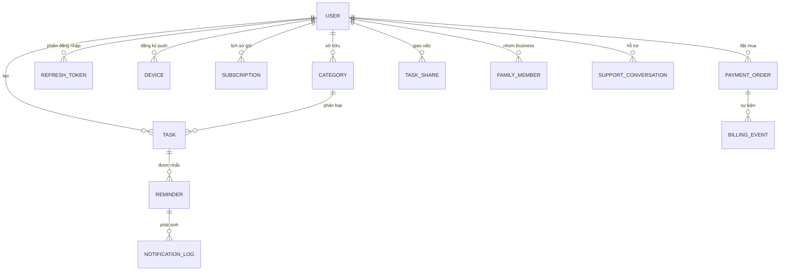
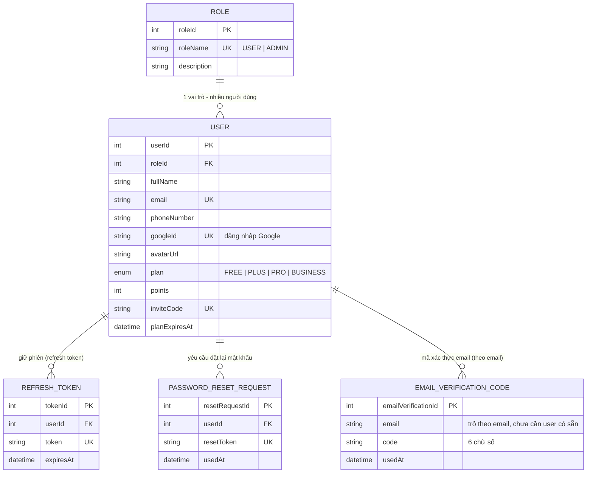
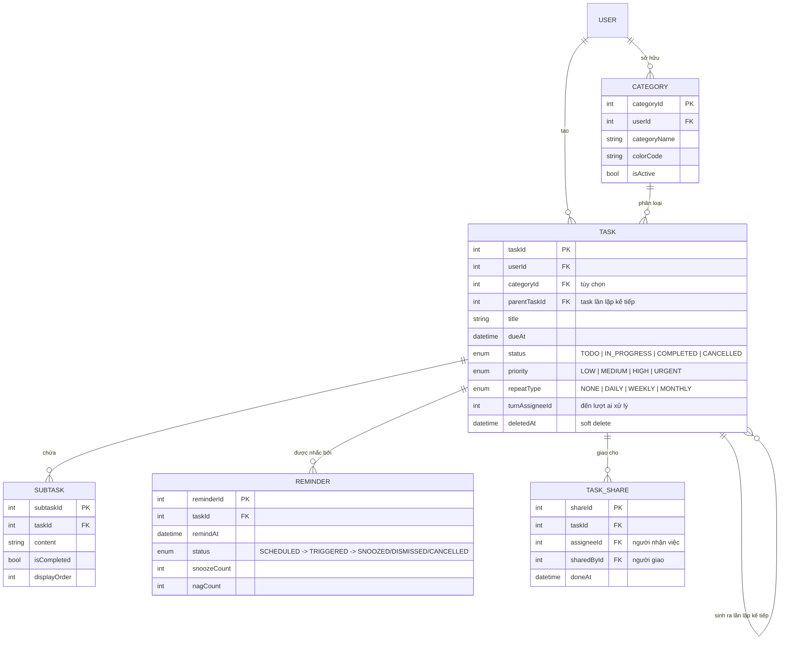
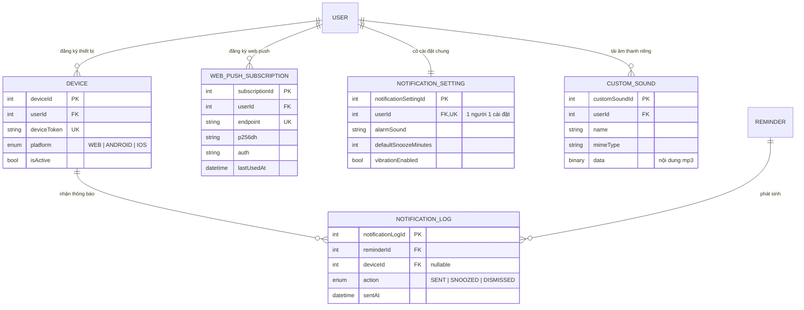
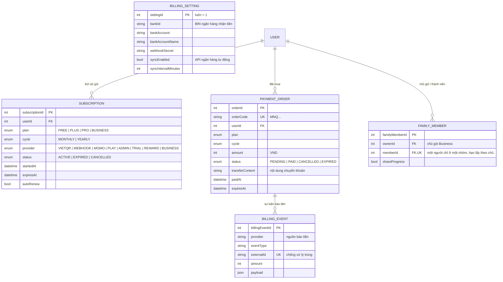
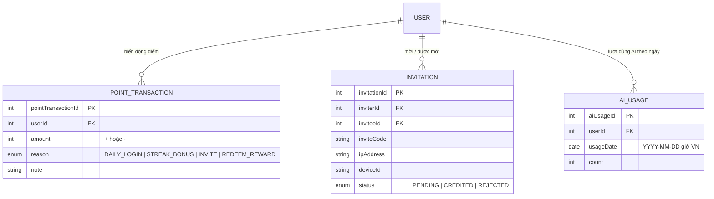
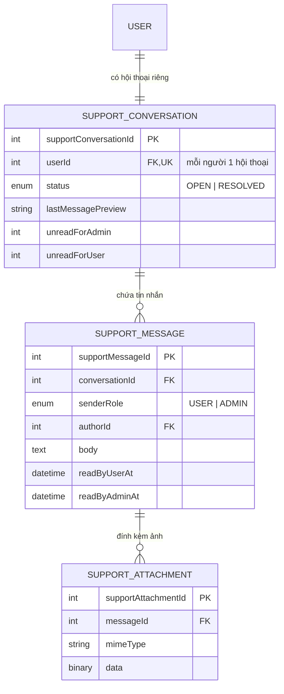

# ERD – MN-Qronx

> ERD phản ánh **đúng schema Prisma đang chạy** (`backend/prisma/schema.prisma`) — 27 model: lõi quản lý công việc & thông báo, cùng các mô-đun thương mại (gói, thanh toán, điểm thưởng, giao việc, gói Doanh nghiệp, AI, hỗ trợ). Tên bảng/cột viết bằng tiếng Anh, ý nghĩa nghiệp vụ theo `01_MN-Qronx_Business_Analysis.md`.

## 1. Mục đích và giả định thiết kế

- Nguồn sự thật là `backend/prisma/schema.prisma`; hai tệp SQL trong `BA/` là bản tham chiếu DDL tương đương.
- `User` lưu cả người dùng thường và Admin; vai trò xác định qua `Role`.
- `Category` thuộc sở hữu riêng của từng người dùng (không dùng chung).
- `Task` có thể tự tham chiếu qua `parentTaskId` để nối các lần lặp lại.
- Xóa công việc là **soft delete** qua `deletedAt`: giữ 30 ngày trong thùng rác rồi scheduler xóa vĩnh viễn.
- `Reminder` có vòng đời trạng thái riêng; bị hủy khi công việc kết thúc sớm.
- Giao việc nằm ở bảng riêng `TaskShare` để một việc giao được nhiều người và người nhận **không** có quyền sửa việc.
- Quyền lợi gói được **vật chất hóa** trên `User.plan`; `Subscription` là lịch sử/nguồn đối chiếu hạn dùng.
- Ảnh và âm thanh lưu trực tiếp trong DB (`Bytes`) để không phụ thuộc dịch vụ lưu file ngoài.

## 2. Bảng liệt kê model

| Nhóm | Model | Bảng vật lý |
|---|---|---|
| Tài khoản | `Role`, `User`, `RefreshToken`, `PasswordResetRequest`, `EmailVerificationCode` | `roles`, `app_users`, `refresh_tokens`, `password_reset_requests`, `email_verification_codes` |
| Công việc | `Category`, `Task`, `Subtask`, `Reminder`, `TaskShare` | `categories`, `tasks`, `subtasks`, `reminders`, `task_shares` |
| Thông báo | `Device`, `WebPushSubscription`, `NotificationSetting`, `NotificationLog`, `CustomSound`, `AppSetting` | `devices`, `web_push_subscriptions`, `notification_settings`, `notification_logs`, `custom_sounds`, `app_settings` |
| Thương mại | `Subscription`, `PaymentOrder`, `BillingEvent`, `BillingSetting`, `FamilyMember` | `subscriptions`, `payment_orders`, `billing_events`, `billing_settings`, `family_members` |
| Tăng trưởng | `PointTransaction`, `Invitation`, `AiUsage` | `point_transactions`, `invitations`, `ai_usage` |
| Hỗ trợ | `SupportConversation`, `SupportMessage`, `SupportAttachment` | `support_conversations`, `support_messages`, `support_attachments` |

## 3. Entity Relationship Diagram

> Một sơ đồ gồm cả 27 model nhìn cùng lúc sẽ rối và khó đọc (giống ERD tự động của pgAdmin).
> Vì vậy ERD được chia theo **6 nhóm nghiệp vụ** — mỗi sơ đồ chỉ chứa vài model có quan hệ
> trực tiếp, đủ nhìn xuyên suốt một luồng. Sơ đồ tổng quan ở mục 3.0 chỉ để *nắm bức tranh lớn*,
> không dán cột chi tiết. Dán từng khối `mermaid` vào [mermaid.live](https://mermaid.live)
> hoặc xem bằng preview Mermaid trong VS Code là có hình ngay.

### 3.0. Tổng quan (mô hình tập trung quanh USER — không cột chi tiết)

### 3.1. Tài khoản & phiên đăng nhập

### 3.2. Công việc & giao việc

### 3.3. Thiết bị & thông báo

### 3.4. Gói, thanh toán & nhóm Business

### 3.5. Điểm thưởng & tăng trưởng

### 3.6. Hỗ trợ khách hàng

## 4. Đặc tả cột theo model

### 4.1. Tài khoản

| Model | Cột chính |
|---|---|
| `Role` | `roleId` PK, `roleName` UK (`USER`/`ADMIN`), `description` |
| `User` | `userId` PK, `roleId` FK, `fullName`, `email` UK, `passwordHash`, `phoneNumber`, `avatarUrl`, `googleId` UK, `plan` (`FREE`/`PLUS`/`PRO`/`BUSINESS`), `planStartedAt`, `planExpiresAt`, `points`, `loginStreak`, `lastLoginDate`, `inviteCode` UK, `referrerId`, `trialStartedAt`, `weeklyReportEnabled`, `weeklyReportSentAt`, `weeklyReportTestAt`, `isActive`, `icsKey`, `createdAt`, `updatedAt` |
| `RefreshToken` | `tokenId` PK, `userId` FK, `token` UK, `expiresAt`, `createdAt` |
| `PasswordResetRequest` | `resetRequestId` PK, `userId` FK, `resetToken` UK, `expiresAt`, `usedAt`, `createdAt` |
| `EmailVerificationCode` | `emailVerificationId` PK, `email`, `code` (6 số), `expiresAt`, `usedAt`, `createdAt` |

### 4.2. Công việc

| Model | Cột chính |
|---|---|
| `Category` | `categoryId` PK, `userId` FK, `categoryName`, `colorCode`, `isActive`, UK(`userId`,`categoryName`) |
| `Task` | `taskId` PK, `userId` FK, `categoryId` FK?, `parentTaskId` FK?, `title`, `description`, `priority`, `status`, `dueAt`, `repeatType`, `repeatDays` (ISO 1–7, dạng "1,3,5"), `completedAt`, `nagEveryMinutes` (1–30, null = tắt), `rotateEnabled`, `turnAssigneeId`, `deletedAt`, `createdAt`, `updatedAt` |
| `Subtask` | `subtaskId` PK, `taskId` FK (cascade), `content`, `isCompleted`, `displayOrder` |
| `Reminder` | `reminderId` PK, `taskId` FK (cascade), `remindAt`, `status`, `snoozeCount`, `nagCount`, `createdAt`, `updatedAt` |
| `TaskShare` | `shareId` PK, `taskId` FK (cascade), `assigneeId` FK, `sharedById` FK, `note`, `doneAt`, UK(`taskId`,`assigneeId`) |

### 4.3. Thông báo

| Model | Cột chính |
|---|---|
| `Device` | `deviceId` PK, `userId` FK, `deviceToken` UK, `platform` (`WEB`/`ANDROID`/`IOS`), `isActive`, `createdAt`, `updatedAt` |
| `WebPushSubscription` | `subscriptionId` PK, `userId` FK, `endpoint` UK, `p256dh`, `auth`, `userAgent`, `createdAt`, `lastUsedAt` |
| `NotificationSetting` | `notificationSettingId` PK, `userId` FK UK, `alarmSound`, `defaultSnoozeMinutes`, `vibrationEnabled`, `createdAt`, `updatedAt` |
| `NotificationLog` | `notificationLogId` PK, `reminderId` FK, `deviceId` FK?, `action` (`SENT`/`SNOOZED`/`DISMISSED`), `sentAt`, `createdAt` |
| `CustomSound` | `customSoundId` PK, `userId` FK, `name`, `mimeType`, `sizeBytes`, `data` (Bytes), `createdAt` |
| `AppSetting` | `key` PK, `value`, `updatedAt` |

### 4.4. Thương mại

| Model | Cột chính |
|---|---|
| `Subscription` | `subscriptionId` PK, `userId` FK, `plan`, `cycle` (`MONTHLY`/`YEARLY`), `provider` (`VIETQR`/`WEBHOOK`/`MOMO`/`PLAY`/`ADMIN`/`TRIAL`/`REWARD`/`BUSINESS`), `status` (`ACTIVE`/`EXPIRED`/`CANCELLED`), `providerRef`, `startedAt`, `expiresAt`, `autoRenew`, `cancelledAt`, `reminderSentAt`, `note` |
| `PaymentOrder` | `orderId` PK, `orderCode` UK (`MNQ…`), `userId` FK, `plan`, `cycle`, `amount` (VND), `status` (`PENDING`/`PAID`/`CANCELLED`/`EXPIRED`), `provider`, `providerRef`, `transferContent`, `qrPayload`, `qrImageUrl`, `qrSource`, `qrCreatedAt`, `paidAt`, `expiresAt`, `confirmedBy`, `note` |
| `BillingEvent` | `billingEventId` PK, `provider`, `eventType`, `externalId` UK (chống trùng), `orderId`, `amount`, `payload` (JSON), `createdAt` |
| `BillingSetting` | `settingId` PK (=1), cấu hình ngân hàng nhận tiền (`bankId`, `bankAccount`, `bankAccountName`, `qrTemplate`, `webhookSecret`), cấu hình API ngân hàng (`bankApi*`, `syncEnabled`, `syncIntervalMinutes`, `lastSync*`, `lastSyncCursor`), nhật ký webhook (`lastWebhook*`), `updatedBy`, `updatedAt` |

### 4.5. Tăng trưởng

| Model | Cột chính |
|---|---|
| `PointTransaction` | `pointTransactionId` PK, `userId` FK, `amount` (±), `reason` (`DAILY_LOGIN`/`STREAK_BONUS`/`INVITE`/`REDEEM_REWARD`), `note`, `createdAt` |
| `Invitation` | `invitationId` PK, `inviterId` FK, `inviteeId` FK, `inviteCode`, `ipAddress`, `deviceId`, `status` (`PENDING`/`CREDITED`/`REJECTED`), `creditedAt`, `createdAt` |
| `AiUsage` | `aiUsageId` PK, `userId` FK, `usageDate` (YYYY-MM-DD theo giờ VN), `count`, `updatedAt`, UK(`userId`,`usageDate`) |

### 4.6. Nhóm Business (bảng `family_members` giữ nguyên tên)

| Model | Cột chính |
|---|---|
| `FamilyMember` | `familyMemberId` PK, `ownerId` FK (chủ gói), `memberId` FK UK (một người chỉ ở một nhóm), `note`, `shareProgress`, `createdAt`, UK(`ownerId`,`memberId`) |

### 4.7. Hỗ trợ

| Model | Cột chính |
|---|---|
| `SupportConversation` | `supportConversationId` PK, `userId` FK UK, `status` (`OPEN`/`RESOLVED`), `lastMessagePreview`, `lastMessageAt`, `unreadForAdmin`, `unreadForUser`, `createdAt`, `updatedAt` |
| `SupportMessage` | `supportMessageId` PK, `conversationId` FK (cascade), `senderRole` (`USER`/`ADMIN`), `authorId` FK?, `body`, `readByUserAt`, `readByAdminAt`, `createdAt` |
| `SupportAttachment` | `supportAttachmentId` PK, `messageId` FK (cascade), `mimeType`, `sizeBytes`, `data` (Bytes), `createdAt` |

## 5. Enum

| Enum | Giá trị |
|---|---|
| `RoleName` | `USER`, `ADMIN` |
| `TaskStatus` | `TODO`, `IN_PROGRESS`, `COMPLETED`, `CANCELLED` |
| `TaskPriority` | `LOW`, `MEDIUM`, `HIGH`, `URGENT` |
| `RepeatType` | `NONE`, `DAILY`, `WEEKLY`, `MONTHLY` |
| `ReminderStatus` | `SCHEDULED`, `TRIGGERED`, `SNOOZED`, `DISMISSED`, `CANCELLED` |
| `NotificationAction` | `SENT`, `SNOOZED`, `DISMISSED` |
| `Platform` | `WEB`, `ANDROID`, `IOS` |
| `Plan` | `FREE`, `PLUS`, `PRO`, `BUSINESS` (Pro Doanh nghiệp dùng chung tối đa 10 tài khoản) |
| `BillingProvider` | `VIETQR`, `WEBHOOK`, `MOMO`, `PLAY`, `ADMIN`, `TRIAL`, `REWARD`, `BUSINESS` (ghế trong nhóm của người khác) |
| `BillingCycle` | `MONTHLY`, `YEARLY` |
| `OrderStatus` | `PENDING`, `PAID`, `CANCELLED`, `EXPIRED` |
| `SubscriptionStatus` | `ACTIVE`, `EXPIRED`, `CANCELLED` |
| `InvitationStatus` | `PENDING`, `CREDITED`, `REJECTED` |
| `SupportStatus` | `OPEN`, `RESOLVED` |
| `SupportSender` | `USER`, `ADMIN` |

## 6. Ràng buộc dữ liệu và nghiệp vụ

| ID | Ràng buộc |
|---|---|
| ERD-R-01 | `email`, `resetToken`, `deviceToken`, `orderCode`, `supportConversationId.userId`, `notificationSetting.userId`, `refreshToken.token`, `webPushSubscription.endpoint`, `billingEvent.externalId`, `inviteCode`, `googleId` phải duy nhất. |
| ERD-R-02 | Cặp (`userId`, `categoryName`) duy nhất. |
| ERD-R-03 | `Task.title` không rỗng; `dueAt` bắt buộc. |
| ERD-R-04 | `Task.status`, `Task.priority`, `Task.repeatType`, `Reminder.status`, `NotificationLog.action`, `Platform`, `Plan`, `OrderStatus`, `SubscriptionStatus`, `InvitationStatus` chỉ nhận giá trị enum. |
| ERD-R-05 | `Task.parentTaskId` (nếu có) trỏ tới Task khác cùng chủ sở hữu. |
| ERD-R-06 | `Reminder.remindAt ≤ Task.dueAt`. |
| ERD-R-07 | Số `Reminder` mỗi Task theo gói: FREE 3, PLUS/PRO/BUSINESS 5. |
| ERD-R-08 | `Reminder.snoozeCount ≤ 3`; `Reminder.nagCount ≤ 10`. |
| ERD-R-09 | `Task` chuyển `COMPLETED`/`CANCELLED` ⇒ mọi `Reminder` `SCHEDULED`/`TRIGGERED` chuyển `CANCELLED` cùng transaction. |
| ERD-R-10 | `Task` lặp lại chuyển `COMPLETED` ⇒ tạo `Task` mới với `parentTaskId` trỏ về bản vừa xong, giữ `categoryId`, `priority`, `repeatType`, `repeatDays`, `nagEveryMinutes` và tạo lại `Reminder` theo hạn mới. |
| ERD-R-11 | `Task.deletedAt` khác null ⇒ ẩn khỏi danh sách/dashboard/báo cáo/kế hoạch; giữ 30 ngày rồi xóa cứng (xóa kèm `TaskShare` theo cascade). |
| ERD-R-12 | UK(`taskId`,`assigneeId`) trên `TaskShare`: một người nhận một việc chỉ một lần. Mỗi việc tối đa 5 người nhận; mỗi người giao tối đa 50 việc đang mở. |
| ERD-R-13 | `FamilyMember.memberId` duy nhất ⇒ một người chỉ ở trong một nhóm. Một gói Business dùng chung tối đa 10 tài khoản (chủ gói + 9 người — `MAX_BUSINESS_SEATS`). |
| ERD-R-14 | Quyền lợi người trong nhóm Business gắn hạn của chủ gói (`User.planExpiresAt`); khi chủ hết hạn, mọi ghế bị thu hồi và dòng `FamilyMember` bị xóa. |
| ERD-R-15 | `Device.deviceToken` gắn đúng một `userId`; gỡ thiết bị = `isActive = false` để giữ `NotificationLog`. |
| ERD-R-16 | `AiUsage` UK(`userId`,`usageDate`); ngày theo múi giờ Việt Nam. |
| ERD-R-17 | `PaymentOrder.orderCode` duy nhất; `BillingEvent.externalId` duy nhất để chống xử lý trùng webhook. |
| ERD-R-18 | `SupportConversation.userId` duy nhất (mỗi người dùng một hội thoại). |
| ERD-R-19 | Ảnh/âm thanh lưu dạng `Bytes` trong DB, có giới hạn kích thước (MIME và dung lượng kiểm ở tầng ứng dụng). |

## 7. Chỉ mục quan trọng phục vụ truy vấn

| Model | Chỉ mục |
|---|---|
| `Task` | (`userId`,`dueAt`), (`userId`,`status`), (`userId`,`deletedAt`), (`categoryId`), (`parentTaskId`) |
| `Reminder` | (`status`,`remindAt`) — phục vụ scheduler quét mỗi phút |
| `Category` | (`userId`,`isActive`) |
| `Subtask` | (`taskId`,`displayOrder`) |
| `NotificationLog` | (`reminderId`,`sentAt`), (`deviceId`) |
| `Device` / `WebPushSubscription` | (`userId`,`isActive`) / (`userId`) |
| `RefreshToken` | (`userId`) |
| `Subscription` | (`userId`,`status`) |
| `PaymentOrder` | (`userId`,`status`) |
| `Invitation` | (`inviterId`), (`inviteeId`) |
| `TaskShare` | (`assigneeId`,`doneAt`), (`sharedById`) |
| `FamilyMember` | (`ownerId`) |
| `SupportConversation` | (`lastMessageAt`), (`unreadForAdmin`) |
| `SupportMessage` | (`conversationId`,`createdAt`) |

## 8. Ghi chú triển khai

- Mọi cột thời gian lưu UTC (`timestamptz`) và được quy đổi sang múi giờ Việt Nam ở tầng ứng dụng (báo cáo, hạn mức AI, chia ngày).
- `Task.turnAssigneeId` là số nguyên "trần" (không phải khóa ngoại): người bị gỡ khỏi việc có thể làm cột này trỏ sai, nên mọi chỗ đọc đều phải đối chiếu lại với `task_shares`.
- `User.plan`/`planExpiresAt` là bản vật chất hóa của `Subscription`; scheduler đồng bộ mỗi phút.
- Việc lên lịch và kích hoạt `Reminder` (scheduler) là trách nhiệm tầng ứng dụng, không mô hình hóa thành entity.
- Dashboard và báo cáo là số liệu tổng hợp từ entity hiện có, không cần bảng riêng.
- `AppSetting`, `BillingSetting` là bảng cấu hình toàn hệ thống (không có khóa ngoại), nên không xuất hiện trong các sơ đồ quan hệ ở mục 3.
