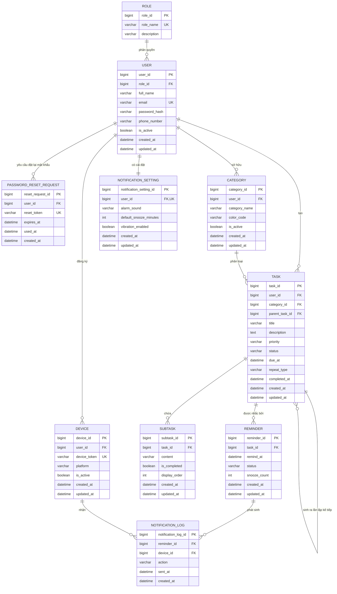

# ERD – TaskAlarm

## 1. Mục đích và giả định thiết kế

ERD này được xây dựng từ các entity nghiệp vụ trong tài liệu BA (`01_TaskAlarm_Business_Analysis.md`, mục 9) và phục vụ bước thiết kế cơ sở dữ liệu tiếp theo. Tên bảng và thuộc tính được thể hiện bằng tiếng Anh để thuận tiện phát triển, trong khi ý nghĩa nghiệp vụ vẫn tuân theo tài liệu BA.

Các giả định được áp dụng:

- `USER` lưu cả người dùng thường và Admin; vai trò được xác định qua `ROLE`.
- `CATEGORY` thuộc sở hữu riêng của từng `USER` (không phải danh mục dùng chung như TechHub); mỗi User tự quản lý danh mục của mình.
- Mỗi `TASK` có thể có nhiều `REMINDER`, tối đa 5 nhắc nhở/công việc theo BR-09.
- `TASK` lặp lại không sửa trực tiếp lên cùng một bản ghi; khi hoàn thành, hệ thống tạo một `TASK` mới và liên kết về `TASK` trước đó qua `parent_task_id`, để giữ nguyên lịch sử từng lần lặp.
- `REMINDER` có vòng đời trạng thái riêng (Đã lên lịch → Đã kích hoạt → Đã hoãn/Đã tắt/Đã hủy), độc lập với trạng thái của `TASK` nhưng bị hủy khi `TASK` hoàn thành/hủy/xóa sớm.
- Mỗi lần hệ thống gửi, hoãn hoặc tắt một `REMINDER` đều tạo một bản ghi `NOTIFICATION_LOG` để phục vụ tra cứu lịch sử thông báo.
- Mỗi `USER` có đúng một `NOTIFICATION_SETTING` lưu tùy chọn cá nhân về âm thanh, thời gian hoãn mặc định và rung.
- `DEVICE` đại diện cho một trình duyệt hoặc điện thoại đã đăng ký nhận thông báo đẩy; một User có thể có nhiều Device.

## 2. Entity Relationship Diagram

## 3. Mô tả entity và khóa chính/khóa ngoại

| Entity | Khóa chính | Khóa ngoại | Vai trò trong hệ thống |
|---|---|---|---|
| ROLE | `role_id` | Không có | Lưu vai trò User hoặc Admin. |
| USER | `user_id` | `role_id` → ROLE | Lưu tài khoản, thông tin cá nhân, thông tin xác thực và trạng thái hoạt động. |
| PASSWORD_RESET_REQUEST | `reset_request_id` | `user_id` → USER | Lưu yêu cầu đặt lại mật khẩu có thời hạn. |
| CATEGORY | `category_id` | `user_id` → USER | Lưu danh mục công việc do từng User tự tạo. |
| TASK | `task_id` | `user_id` → USER; `category_id` → CATEGORY; `parent_task_id` → TASK (tự tham chiếu) | Lưu thông tin công việc, trạng thái, thời hạn và cấu hình lặp lại. |
| SUBTASK | `subtask_id` | `task_id` → TASK | Lưu từng việc con (checklist item) thuộc một công việc. |
| REMINDER | `reminder_id` | `task_id` → TASK | Lưu từng thời điểm nhắc nhở và trạng thái vòng đời của nhắc nhở đó. |
| DEVICE | `device_id` | `user_id` → USER | Lưu thiết bị đã đăng ký nhận thông báo đẩy cho một User. |
| NOTIFICATION_LOG | `notification_log_id` | `reminder_id` → REMINDER; `device_id` → DEVICE | Lưu lịch sử mỗi lần gửi/hoãn/tắt một nhắc nhở tới từng thiết bị. |
| NOTIFICATION_SETTING | `notification_setting_id` | `user_id` → USER | Lưu tùy chọn thông báo cá nhân của từng User. |

## 4. Ràng buộc dữ liệu và nghiệp vụ cần áp dụng

| ID | Ràng buộc |
|---|---|
| ERD-R-01 | `USER.email`, `PASSWORD_RESET_REQUEST.reset_token` và `DEVICE.device_token` phải là duy nhất toàn hệ thống. |
| ERD-R-02 | `NOTIFICATION_SETTING.user_id` phải là duy nhất để mỗi User chỉ có đúng một cấu hình thông báo. |
| ERD-R-03 | Cặp `CATEGORY.user_id` và `CATEGORY.category_name` phải là duy nhất; một User không được tạo hai danh mục trùng tên. |
| ERD-R-04 | `TASK.title` không được để trống. |
| ERD-R-05 | `TASK.status` chỉ nhận một trong các giá trị: `TODO`, `IN_PROGRESS`, `COMPLETED`, `CANCELLED`. |
| ERD-R-06 | `TASK.priority` chỉ nhận một trong các giá trị: `LOW`, `MEDIUM`, `HIGH`, `URGENT`. |
| ERD-R-07 | `TASK.repeat_type` chỉ nhận một trong các giá trị: `NONE`, `DAILY`, `WEEKLY`, `MONTHLY`. |
| ERD-R-08 | `TASK.parent_task_id`, nếu có, phải trỏ đến một TASK khác thuộc cùng `user_id`. |
| ERD-R-09 | `REMINDER.remind_at` phải nhỏ hơn hoặc bằng `TASK.due_at` của công việc chứa nó. |
| ERD-R-10 | Mỗi `TASK` có tối đa 5 `REMINDER` đang ở trạng thái khác `CANCELLED`. |
| ERD-R-11 | `REMINDER.status` chỉ nhận một trong các giá trị: `SCHEDULED`, `TRIGGERED`, `SNOOZED`, `DISMISSED`, `CANCELLED`. |
| ERD-R-12 | `REMINDER.snooze_count` không được vượt quá 3. |
| ERD-R-13 | Khi `TASK.status` chuyển sang `COMPLETED` hoặc `CANCELLED`, mọi `REMINDER` của Task đó đang ở trạng thái `SCHEDULED` hoặc `TRIGGERED` phải được chuyển sang `CANCELLED` trong cùng transaction. |
| ERD-R-14 | Khi `TASK` có `repeat_type` khác `NONE` chuyển sang `COMPLETED`, hệ thống phải tạo một `TASK` mới với `parent_task_id` trỏ về `TASK` vừa hoàn thành, giữ nguyên `category_id`, `priority`, `repeat_type` và sao chép cấu hình `REMINDER` tương ứng theo thời hạn mới. |
| ERD-R-15 | `NOTIFICATION_LOG.action` chỉ nhận một trong các giá trị: `SENT`, `SNOOZED`, `DISMISSED`. |
| ERD-R-16 | `DEVICE.device_token` phải gắn với đúng một `user_id` tại một thời điểm; khi thiết bị được gỡ, chuyển `is_active = false` thay vì xóa để giữ lịch sử `NOTIFICATION_LOG`. |
| ERD-R-17 | `CATEGORY` không được xóa cứng khi đang có `TASK` tham chiếu; Admin/User chỉ có thể chuyển `is_active = false` để ẩn. |
| ERD-R-18 | `TASK`, `REMINDER` và `NOTIFICATION_LOG` không được xóa cứng khỏi hệ thống để bảo toàn lịch sử; `TASK` bị người dùng "xóa" chỉ được đánh dấu ẩn ở tầng ứng dụng nếu cần khôi phục, hoặc xóa cứng chỉ khi chưa từng phát sinh `NOTIFICATION_LOG` nào. |

## 5. Ghi chú triển khai ERD

- `remind_at` và mọi cột thời gian khác nên lưu theo UTC (`timestamptz`/`datetimeoffset`); tầng ứng dụng quy đổi theo múi giờ thiết bị khi hiển thị, theo đúng giả định 1.7 trong BA.
- `TASK.parent_task_id` cho phép truy vết toàn bộ chuỗi các lần lặp của một công việc định kỳ; truy vấn "lần lặp gần nhất" có thể thực hiện bằng cách lần theo chuỗi này hoặc thêm cột `root_task_id` nếu cần tối ưu truy vấn sau này (không bắt buộc ở giai đoạn này theo nguyên tắc YAGNI).
- `NOTIFICATION_LOG.device_id` có thể để trống (nullable) khi nhắc nhở chỉ hiển thị trong ứng dụng (in-app) mà không gửi qua thiết bị đẩy cụ thể.
- Việc lên lịch và kích hoạt `REMINDER` đúng giờ (NFR-06, NFR-07) là trách nhiệm của tầng ứng dụng/scheduler, không mô hình hóa thành entity riêng trong ERD.
- Dashboard cá nhân và dashboard hệ thống là dữ liệu tổng hợp từ các entity hiện có; không cần entity riêng.
