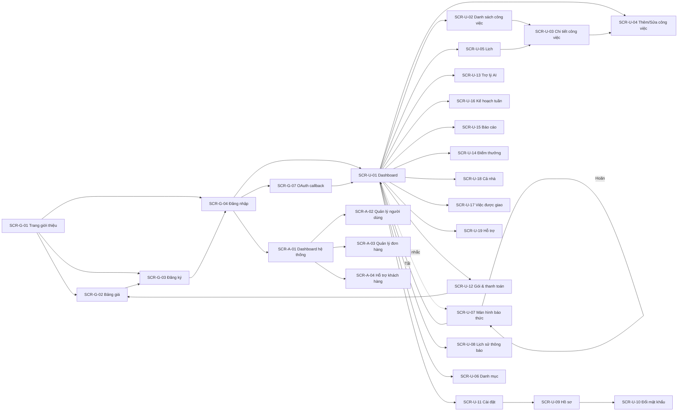

# Wireframe Specification – MN-Qronx

> Tài liệu này thay thế `06_TaskAlarm_Wireframe_Specification.md`. Danh sách màn hình khớp với router thật trong `src/App.jsx` và menu trong `src/components/layout/NavItems.js`.

## 1. Design System tóm tắt

- **Thương hiệu**: Navy `#0D1B2A` · Blue `#2563EB` · Cyan `#06B6D4` · Purple `#8B5CF6`; chữ chính `text-slate-800`, nền sáng `bg-slate-50`, card `bg-white`.
- **Chế độ tối**: có (`ThemeContext`), tôn trọng cài đặt hệ thống và cho phép người dùng chọn.
- **Song ngữ**: Tiếng Việt / English (`LanguageContext` + `src/i18n/`).
- **Biểu tượng**: Phosphor (`@phosphor-icons/react`) — không dùng emoji làm biểu tượng chức năng.
- **Font**: Plus Jakarta Sans.
- **Badge trạng thái công việc**:
  - `TODO` (Chưa làm): Slate
  - `IN_PROGRESS` (Đang làm): Xanh dương
  - `COMPLETED` (Hoàn thành): Xanh lá
  - `CANCELLED` (Đã hủy): Đỏ
  - `OVERDUE` (Quá hạn — chỉ hiển thị): Hổ phách + icon cảnh báo
- **Badge mức ưu tiên**: `LOW` Slate, `MEDIUM` Xanh dương, `HIGH` Hổ phách, `URGENT` Đỏ.
- **Badge gói**: Miễn phí (Slate), Plus (Xanh dương), Pro (Tím), Pro Doanh nghiệp (Hồng).
- **Component dùng lại**: `Button`, `Input`, `Select`, `Badge`, `Modal`, `Toast`, `Avatar`, `Feedback`, `VoiceButton`, `SupportBadge`, `UpdateNotification`.
- **Layout User**: `AppShell` gồm Sidebar (desktop) / BottomNav + drawer (mobile) + Header. Nút tạo nhanh (`QuickCapture`) và nút chuông mô phỏng báo thức luôn sẵn sàng.
- **Layout Admin**: `AdminShell` với menu riêng.
- **Menu User (Sidebar)**:
  - Nhóm chính: Dashboard · Công việc · Lịch · Việc được giao · **Cả nhà** (Pro) · **Kế hoạch tuần** (Pro) · **Báo cáo** (Pro)
  - Nhóm AI: **Trợ lý AI** (Pro)
  - Nhóm quản lý: Danh mục · Lịch sử thông báo · Điểm thưởng
  - Nhóm khác: Hỗ trợ (kèm huy hiệu chưa đọc) · Cài đặt
- **BottomNav (mobile)**: Dashboard · Công việc · Lịch · Cài đặt (≤ 5 mục) + FAB tạo nhanh.

## 2. Màn hình Guest

### SCR-G-01 — Trang giới thiệu (`/`)
- **Mục đích**: Giới thiệu MN-Qronx, kêu gọi đăng ký.
- **Bố cục**: Hero (tiêu đề + khẩu hiệu "Plan. Do. On Time." + nút "Bắt đầu miễn phí"), khối tính năng nổi bật (quản lý công việc, nhắc kiểu báo thức, trợ lý AI, giao việc, báo cáo), phần gói, footer.

### SCR-G-02 — Bảng giá (`/pricing`)
- **Bố cục**: 4 thẻ gói (Miễn phí/Plus/Pro/Pro Doanh nghiệp) với giá tháng/năm (nút đổi kỳ), danh sách quyền lợi, nhãn "Sắp có" cho hạng mục chưa làm. Nút CTA theo trạng thái đăng nhập.

### SCR-G-03 — Đăng ký (`/register`)
- **Bố cục**: Form họ tên, email, mật khẩu, xác nhận mật khẩu; sau khi gửi, chuyển sang bước **nhập mã xác nhận email** (gửi lại mã có giới hạn thời gian). Có nút đăng ký bằng Google.

### SCR-G-04 — Đăng nhập (`/login`)
- **Bố cục**: Email, mật khẩu, nút đăng nhập, nút **Đăng nhập bằng Google**, link "Quên mật khẩu?", link sang đăng ký.
- **Trạng thái**: Toast lỗi khi sai thông tin hoặc tài khoản bị khóa.

### SCR-G-05 — Quên mật khẩu (`/forgot-password`)
- **Bố cục**: Nhập email, nút gửi; sau khi gửi hiển thị thông báo kiểm tra email (không tiết lộ email có tồn tại).

### SCR-G-06 — Đặt lại mật khẩu (`/reset-password`)
- **Bố cục**: Mật khẩu mới + xác nhận (truy cập qua link email chứa `resetToken`). Báo lỗi nếu token hết hạn.

### SCR-G-07 — Callback OAuth (`/oauth-callback`)
- **Bố cục**: Màn hình chờ nhận token từ Google rồi chuyển vào `/app`.

## 3. Màn hình User

### SCR-U-01 — Dashboard cá nhân (`/app`)
- **Bố cục**: 4 thẻ số liệu (Hôm nay / Quá hạn / Hoàn thành / Sắp tới), danh sách rút gọn "Công việc hôm nay" và "Quá hạn", nút tạo nhanh.
- **Trạng thái rỗng/loading**: minh họa + CTA; skeleton cho thẻ và danh sách.

### SCR-U-02 — Danh sách công việc (`/app/tasks`)
- **Bố cục**: Thanh lọc (Trạng thái, Ưu tiên, Danh mục, Khoảng thời gian) + ô tìm kiếm; danh sách item (checkbox hoàn thành nhanh, tiêu đề, badge danh mục/ưu tiên/trạng thái, giờ hạn, icon chuông nếu có nhắc, nhãn nhắc dai).
- **Tab thùng rác**: danh sách việc đã xóa, nút **Khôi phục** từng việc và **Dọn thùng rác**.

### SCR-U-03 — Chi tiết công việc (`/app/tasks/:id`)
- **Bố cục**: Header (tiêu đề, badge, menu Sửa/Xóa/Hủy); mô tả; **việc con**; **nhắc nhở** (danh sách chip giờ nhắc + nút thêm, cảnh báo khi đủ hạn mức gói); khối **lặp lại**; khối **giao việc** (danh sách người nhận + tổng kết xong); công tắc **luân phiên**; **nhắc dai** (chọn chu kỳ); nút lớn "Đánh dấu hoàn thành".
- **Trạng thái**: việc đã Hoàn thành/Đã hủy thì ẩn nút thêm nhắc nhở/việc con, hiện nút "Mở lại".

### SCR-U-04 — Thêm/Sửa công việc (`/app/tasks/new`, `/app/tasks/:id/edit`)
- **Bố cục**: 1 cột mobile, 2 cột desktop: Tiêu đề (bắt buộc), Mô tả, Danh mục (kèm tạo nhanh), Mức ưu tiên (segmented 4 mức), Ngày & Giờ hạn, Lặp lại (segmented + chọn thứ khi Hằng tuần), Nhắc dai (chỉ Pro, hiện khung nâng cấp nếu chưa có), danh sách Nhắc nhở, checklist việc con.
- **Validate inline**: cảnh báo nếu giờ nhắc sau giờ hạn; vô hiệu nút Lưu khi có lỗi.

### SCR-U-05 — Lịch (`/app/calendar`)
- **Bố cục**: Tab Ngày/Tuần/Tháng; lưới lịch có chấm màu theo danh mục; click ngày mở danh sách việc (bottom sheet mobile / panel desktop). Nút **Xuất lịch `.ics`** (sao chép URL) và **Tạo lại khóa**.

### SCR-U-06 — Danh mục (`/app/categories`)
- **Bố cục**: Danh sách chip màu + tên + số việc; nút "Danh mục mới" mở modal (tên + chọn màu); menu Sửa/Ẩn. Danh mục ẩn hiển thị mờ kèm toggle hiện lại.

### SCR-U-07 — Màn hình báo thức (overlay toàn cục) ⭐ Tính năng cốt lõi
- **Mục đích**: Hiển thị toàn màn hình khi reminder kích hoạt, đảm bảo không thể bỏ qua.
- **Bố cục**:
  - Overlay trên mọi route; màu nền theo mức ưu tiên (URGENT tông đỏ).
  - Icon chuông lớn có hiệu ứng rung; tiêu đề việc, giờ hạn, badge danh mục.
  - Hai nút lớn: **"Hoãn {X} phút"** (secondary, dùng `defaultSnoozeMinutes`) và **"Tắt"** (primary). Hoãn bị ẩn/vô hiệu khi đã hoãn đủ 3 lần, kèm ghi chú "Đã hoãn tối đa".
  - Âm thanh lặp tới khi Hoãn/Tắt; có nút tắt tiếng tạm thời nhưng giữ màn hình.
  - Nếu đang bật nhắc dai, hiển thị nhắc rằng chuông sẽ còn kêu lại cho tới khi xác nhận xong.
- **Trên PWA**: kết hợp Web Push → bấm thông báo hệ thống mở/focus tab và hiện overlay.

### SCR-U-08 — Lịch sử thông báo (`/app/notifications`)
- **Bố cục**: Danh sách giảm dần theo thời gian (tên việc, thời điểm, badge Đã gửi/Đã hoãn/Đã tắt, thiết bị nhận), lọc theo khoảng thời gian, phân trang.

### SCR-U-09 — Hồ sơ cá nhân (`/app/profile`)
- **Bố cục**: Ảnh đại diện, họ tên, email (readonly), số điện thoại; badge gói; thẻ thống kê; hoạt động gần đây; nút lưu.

### SCR-U-10 — Đổi mật khẩu (`/app/change-password`)
- **Bố cục**: Mật khẩu hiện tại, mật khẩu mới, xác nhận. Cảnh báo rằng đổi mật khẩu sẽ đăng xuất mọi thiết bị.

### SCR-U-11 — Cài đặt (`/app/settings`)
- **Bố cục**: Các nhóm: **Thông báo** (âm thanh báo thức kèm nút nghe thử, thời gian hoãn mặc định 5/10/15/30, bật/tắt rung), **Âm thanh riêng** (danh sách + nhập/xóa, chỉ Plus/Pro), **Nhắc khi đóng trình duyệt** (bật Web Push, trạng thái subscription), **Thiết bị** (danh sách + gỡ), **Báo cáo tuần** (bật/tắt + gửi thử), **Giao diện** (chế độ tối, ngôn ngữ).

### SCR-U-12 — Gói & thanh toán (`/app/billing`)
- **Bố cục**: Thẻ gói hiện tại + hạn dùng; bảng so sánh 4 gói (đổi kỳ tháng/năm); nút mua; nút **Dùng thử Pro 7 ngày** (ẩn nếu đã dùng); khối thanh toán khi có đơn chờ (mã đơn, mã QR, số tài khoản, nút "Tôi đã chuyển", hủy đơn); lịch sử quyền lợi.

### SCR-U-13 — Trợ lý AI (`/app/ai`)
- **Bố cục**: Khung chat nhập câu (hoặc nút mic); bong bóng kết quả liệt kê công việc nhận diện kèm nút "Tạo"; bộ đếm lượt còn lại trong ngày; nhắc rằng lượt chỉ bị trừ khi thành công; khung nâng cấp khi hết lượt.

### SCR-U-14 — Điểm thưởng (`/app/rewards`)
- **Bố cục**: Số điểm hiện có, chuỗi đăng nhập + mốc kế tiếp, mã mời (kèm nút sao chép/chia sẻ), bảng đổi thưởng (tiến độ tới từng mức), lịch sử điểm, danh sách lời mời đã gửi.

### SCR-U-15 — Báo cáo năng suất (`/app/reports`)
- **Bố cục**: Bộ chọn khoảng 7/30/90 ngày; thẻ tổng quan (việc xong, đúng hạn, tỉ lệ); biểu đồ theo ngày/thứ/giờ; việc tồn đọng lâu nhất; thống kê theo danh mục; số việc được "nhắc dai" cứu; nút **Xuất CSV**. Khung nâng cấp cho gói không có quyền.

### SCR-U-16 — Kế hoạch tuần (`/app/planner`)
- **Bố cục**: Bộ chọn năng lực/ngày (3/5/8/10); 7 cột ngày với việc được xếp; khối cảnh báo **việc sẽ trễ** (kèm số ngày trễ và gợi ý dời hạn); đếm việc ngoài cửa sổ tuần.

### SCR-U-17 — Việc được giao (`/app/assigned`)
- **Bố cục**: Danh sách việc người khác nhờ (tiêu đề, người giao, hạn, lời nhắn), nút **"Xong phần của tôi"**, nhãn phân biệt phần đã xong.

### SCR-U-18 — Cả nhà (`/app/family`)
- **Bố cục (chủ gói)**: Trạng thái gói, số ghế còn trống, danh sách thành viên (kèm toggle bật/tắt chia sẻ tiến độ của họ ở góc nhìn thành viên), ô mời theo email, nút gỡ; **bảng tiến độ "Cả nhà hôm nay"**.
- **Bố cục (thành viên)**: Cho biết đang dùng gói của ai, ngày hết hạn chung, công tắc tự chia sẻ tiến độ, nút rời nhóm.
- **Bố cục (chưa có gói)**: Khung mời mua Pro Doanh nghiệp kèm lợi ích.

### SCR-U-19 — Hỗ trợ (`/app/support`)
- **Bố cục**: Khung chat với admin (bong bóng hai phía), nút gửi ảnh (tối đa 3), chỉ báo đang gõ/đã đọc, trạng thái hội thoại; tự động cuộn tới tin mới.

## 4. Màn hình Admin

### SCR-A-01 — Dashboard hệ thống (`/admin`)
- **Bố cục**: Thẻ số liệu (tổng người dùng, tổng công việc, công việc đang mở, thông báo hôm nay) và biểu đồ đơn giản.

### SCR-A-02 — Quản lý người dùng (`/admin/users`)
- **Bố cục**: Bảng người dùng (họ tên, email, vai trò, gói, trạng thái, ngày tạo), ô tìm kiếm, nút **Tạo tài khoản**, nút **Khóa/Mở khóa**, chọn **Đổi gói**, nút **Xóa vĩnh viễn** (kèm xác nhận, từ chối với tài khoản Admin).
- **Ràng buộc UI**: Không có nút xem chi tiết công việc của người dùng (BR-58).

### SCR-A-03 — Quản lý đơn hàng (`/admin/orders`)
- **Bố cục**: Bộ lọc trạng thái / mã đơn / email; bảng đơn (mã, khách, gói, kỳ, số tiền, trạng thái, thời điểm); nút **Xác nhận** / **Hủy**; khối **giao dịch chưa khớp** để gán vào đơn; khu **Cấu hình nhận tiền** (ngân hàng, số tài khoản, mã webhook + URL dán vào SePay/Casso, nút xoay mã, gửi thử webhook, kiểm tra kết nối API ngân hàng, đồng bộ ngay) và **nhật ký webhook gần nhất** (có gọi tới không, mã gì, vì sao từ chối).

### SCR-A-04 — Hỗ trợ khách hàng (`/admin/support`)
- **Bố cục**: Danh sách hội thoại (khách, xem trước tin cuối, số chưa đọc, trạng thái); panel chat để trả lời (kèm gửi ảnh); nút **Đánh dấu đã đọc** và **Chuyển trạng thái Đã xong/Đang xử lý**.

## 5. Luồng điều hướng chính (Navigation Flow)

## 6. Ghi chú triển khai UI

- Màn hình báo thức (SCR-U-07) phải phủ mọi z-index/route và **không thể đóng bằng nút back** — chỉ đóng qua Hoãn hoặc Tắt.
- Mọi thao tác tạo/sửa việc, hoãn/tắt báo thức phải có phản hồi tức thì (optimistic UI hoặc loading rõ ràng).
- Trang dành riêng cho gói Pro (Kế hoạch tuần, Báo cáo, Trợ lý AI, Cả nhà) khi người dùng chưa có quyền phải hiển thị **khung nâng cấp** kèm lợi ích, không ẩn hoàn toàn.
- Dùng Toast cho thông báo thành công/lỗi ở mọi màn hình, riêng SCR-U-07 không dùng Toast mà dùng chính overlay làm kênh thông báo.
- PWA: có `manifest.json` + service worker (`public/sw.js`) để cài lên màn hình chính và nhận thông báo khi tab đã đóng; API không bao giờ bị cache.
- Trợ năng: focus ring rõ, `aria-label`, điều hướng bàn phím, tương phản ≥ 4.5:1, tôn trọng `prefers-reduced-motion`; nút chạm tối thiểu 44px.
