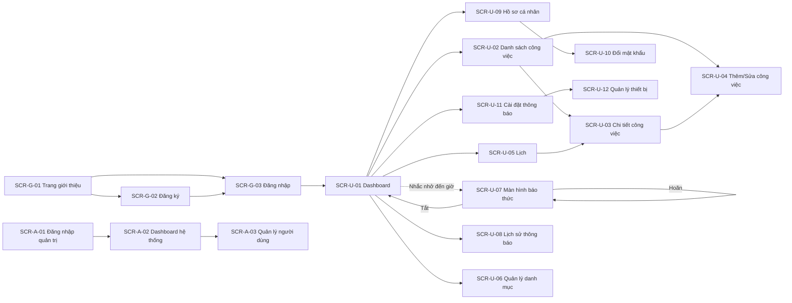

# Wireframe Specification – TaskAlarm

## 1. Design System tóm tắt

- **Tông màu chủ đạo**: Primary Indigo/Blue (`bg-blue-600`, `hover:bg-blue-700`, `text-blue-600`); Nền `bg-slate-50`, Card `bg-white`, chữ chính `text-slate-800`.
- **Badge trạng thái công việc** (4 giá trị lưu + 1 trạng thái hiển thị tính toán):
  - `TODO` (Chưa làm): Slate (`bg-slate-100 text-slate-700`)
  - `IN_PROGRESS` (Đang làm): Xanh dương (`bg-blue-100 text-blue-800`)
  - `COMPLETED` (Hoàn thành): Xanh lá (`bg-emerald-100 text-emerald-800`)
  - `CANCELLED` (Đã hủy): Đỏ (`bg-rose-100 text-rose-800`)
  - `OVERDUE` (Quá hạn — chỉ hiển thị, không lưu DB): Cam đậm (`bg-amber-100 text-amber-800`, kèm icon cảnh báo)
- **Badge mức ưu tiên**: `LOW` Slate, `MEDIUM` Xanh dương, `HIGH` Cam (`bg-amber-100 text-amber-800`), `URGENT` Đỏ (`bg-rose-100 text-rose-800`, có thể thêm icon chấm than).
- **Component dùng lại**: `Button`, `Input`, `Select`, `DatePicker`/`TimePicker`, `Badge`, `Modal`, `Toast`, `Spinner`, `EmptyState`, `Pagination`, `ColorPicker` (cho danh mục).
- **Layout chuẩn User area**: Sidebar/BottomNav (Mobile) bên trái + Nội dung chính bên phải; Header trên cùng gồm nút "Tạo công việc" nổi bật (`+`) luôn hiển thị.
- **Responsive**: Desktop dùng Sidebar cố định; Tablet Sidebar thu gọn dạng icon; Mobile dùng Bottom Tab Bar (Dashboard, Danh sách, Lịch, Cài đặt) + nút "+" nổi (FAB) để tạo công việc nhanh.

## 2. Màn hình Guest

### SCR-G-01 — Trang giới thiệu
- **Mục đích**: Giới thiệu TaskAlarm, kêu gọi đăng ký.
- **Bố cục**: Hero section (tiêu đề + mô tả ngắn + nút "Bắt đầu miễn phí"), phần minh họa 3 tính năng nổi bật (Quản lý công việc, Nhắc nhở kiểu báo thức, Đồng bộ Web/Mobile), Footer với link Đăng nhập.
- **Thành phần chính**: Nút CTA `Đăng ký` (primary), `Đăng nhập` (secondary/link).

### SCR-G-02 — Đăng ký
- **Bố cục**: Form giữa màn hình: Họ tên, Email, Mật khẩu, Xác nhận mật khẩu, nút "Đăng ký".
- **Trạng thái**: Loading trên nút khi submit; Toast lỗi nếu email đã tồn tại; validate realtime từng field.

### SCR-G-03 — Đăng nhập
- **Bố cục**: Form Email, Mật khẩu, nút "Đăng nhập", link "Quên mật khẩu?", link chuyển sang Đăng ký.
- **Trạng thái**: Toast lỗi khi sai thông tin đăng nhập hoặc tài khoản bị khóa (message riêng: "Tài khoản của bạn đã bị khóa").

### SCR-G-04 — Quên mật khẩu
- **Bố cục**: Form nhập Email, nút "Gửi yêu cầu". Sau khi gửi, hiển thị thông báo kiểm tra email (không tiết lộ email có tồn tại hay không, tránh dò email).

### SCR-G-05 — Đặt lại mật khẩu
- **Bố cục**: Form Mật khẩu mới, Xác nhận mật khẩu mới (truy cập qua link trong email chứa `resetToken`).
- **Trạng thái**: Báo lỗi nếu token hết hạn/không hợp lệ, kèm link quay lại "Quên mật khẩu".

## 3. Màn hình User

### SCR-U-01 — Dashboard cá nhân
- **Bố cục**: 4 thẻ số liệu trên cùng (Hôm nay / Quá hạn / Hoàn thành / Sắp tới), bên dưới là danh sách rút gọn "Công việc hôm nay" và "Công việc quá hạn" (mỗi mục có badge trạng thái + ưu tiên, click vào mở chi tiết).
- **Trạng thái rỗng**: Khi không có công việc nào hôm nay — hình minh họa + text "Hôm nay bạn rảnh rỗi 🎉" + nút "Tạo công việc mới".
- **Loading**: Skeleton cho 4 thẻ số liệu và danh sách.

### SCR-U-02 — Danh sách công việc
- **Bố cục**: Thanh filter trên cùng (Trạng thái, Ưu tiên, Danh mục, Khoảng thời gian) + ô tìm kiếm từ khóa; Danh sách công việc dạng thẻ/hàng, mỗi item gồm: checkbox nhanh đánh dấu hoàn thành, tiêu đề, badge danh mục (màu), badge ưu tiên, badge trạng thái (kèm "Quá hạn" nếu có), giờ đến hạn, icon chuông nếu có reminder.
- **Trạng thái rỗng**: Không có công việc khớp filter — hình minh họa + nút "Xóa bộ lọc".
- **Tương tác**: Vuốt trái trên Mobile để hiện nút Xóa/Hoàn thành nhanh; Pagination ở Desktop.

### SCR-U-03 — Chi tiết công việc
- **Bố cục**: Header gồm tiêu đề, badge trạng thái/ưu tiên, nút menu (Sửa/Xóa/Hủy); Phần mô tả; Phần "Việc con" (checklist, thêm nhanh bằng input + Enter); Phần "Nhắc nhở" (danh sách chip giờ nhắc, nút "+ Thêm nhắc nhở"); Phần "Lặp lại" hiển thị chu kỳ nếu có; nút lớn "Đánh dấu hoàn thành" ở cuối.
- **Trạng thái**: Nếu Task đã `COMPLETED`/`CANCELLED`, ẩn nút thêm nhắc nhở/việc con, hiển thị nút "Mở lại".

### SCR-U-04 — Thêm/Sửa công việc
- **Bố cục**: Form 1 cột trên Mobile, 2 cột trên Desktop: Tiêu đề (bắt buộc), Mô tả, Danh mục (Select + nút tạo nhanh danh mục), Mức ưu tiên (Segmented control 4 mức có màu), Ngày & Giờ đến hạn (DatePicker + TimePicker), Lặp lại (Segmented: Không lặp/Hằng ngày/Hằng tuần/Hằng tháng), Danh sách Nhắc nhở (mỗi dòng: chọn kiểu "Trước X phút/giờ" hoặc chọn giờ cụ thể, nút xóa dòng, nút "+ Thêm nhắc nhở", disable khi đã đủ 5), Checklist việc con (tùy chọn thêm ngay lúc tạo).
- **Validate**: Cảnh báo inline nếu giờ nhắc nhở sau giờ đến hạn; disable nút Lưu khi có lỗi.

### SCR-U-05 — Lịch (Calendar View)
- **Bố cục**: Tab chuyển Ngày/Tuần/Tháng ở trên; lưới lịch hiển thị chấm màu theo danh mục trên từng ngày có công việc; click vào một ngày mở danh sách công việc của ngày đó dạng bottom sheet (Mobile) hoặc panel bên phải (Desktop).
- **Trạng thái rỗng**: Ngày không có công việc — hiển thị "Không có công việc" nhẹ nhàng trong panel.

### SCR-U-06 — Quản lý danh mục
- **Bố cục**: Danh sách danh mục dạng chip màu + tên + số lượng công việc; nút "+ Danh mục mới" mở Modal (Tên, chọn màu qua ColorPicker); mỗi danh mục có menu Sửa/Ẩn.
- **Trạng thái**: Danh mục bị ẩn hiển thị mờ, có toggle để hiện lại.

### SCR-U-07 — Màn hình báo thức (Alarm Screen) ⭐ Tính năng cốt lõi
- **Mục đích**: Hiển thị toàn màn hình khi một Reminder được kích hoạt, mô phỏng trải nghiệm báo thức điện thoại, đảm bảo User không thể bỏ qua.
- **Bố cục**:
  - Nền chiếm toàn bộ màn hình (overlay trên mọi màn hình khác đang mở), màu nền theo mức ưu tiên của công việc (ví dụ `URGENT` dùng tông đỏ nhẹ, các mức khác dùng tông xanh dương mặc định) để tăng nhận diện khẩn cấp.
  - Icon chuông lớn ở giữa với hiệu ứng rung/lắc nhẹ (animation) trong lúc báo thức đang kêu.
  - Tiêu đề công việc (font lớn, đậm), thời hạn (giờ:phút), badge danh mục.
  - Hai nút lớn cạnh nhau ở dưới cùng, dễ bấm bằng ngón cái trên Mobile:
    - **"Hoãn {X} phút"** (secondary, dùng `defaultSnoozeMinutes` từ cài đặt) — ẩn/disable khi đã hoãn đủ 3 lần, thay bằng ghi chú nhỏ "Đã hoãn tối đa số lần cho phép".
    - **"Tắt"** (primary, nổi bật nhất màn hình).
  - Âm thanh báo thức phát lặp lại liên tục cho đến khi User bấm Hoãn hoặc Tắt; có nút tắt tiếng tạm thời (mute icon góc trên) nhưng vẫn giữ màn hình hiển thị.
- **Trên Mobile App**: đây là local/push notification full-screen intent (Android) hoặc Critical/Time-Sensitive Notification (iOS), có thể bật màn hình đang khóa.
- **Trên Website**: hiển thị dưới dạng overlay toàn trang nếu tab đang mở; nếu tab không mở, gửi Web Push kèm âm thanh khi User click vào thông báo để mở lại overlay này.

### SCR-U-08 — Lịch sử thông báo
- **Bố cục**: Danh sách theo thời gian giảm dần, mỗi dòng: tên công việc, thời điểm gửi, hành động (Đã gửi/Đã hoãn/Đã tắt) dạng badge nhỏ, thiết bị nhận (nếu có). Filter theo khoảng thời gian.
- **Trạng thái rỗng**: "Chưa có thông báo nào được gửi."

### SCR-U-09 — Hồ sơ cá nhân
- **Bố cục**: Form Họ tên, Email (readonly), Số điện thoại; nút "Lưu thay đổi".

### SCR-U-10 — Đổi mật khẩu
- **Bố cục**: Form Mật khẩu hiện tại, Mật khẩu mới, Xác nhận mật khẩu mới.

### SCR-U-11 — Cài đặt thông báo
- **Bố cục**: Chọn Âm thanh báo thức (danh sách preset, có nút nghe thử), Thời gian hoãn mặc định (Slider/Select: 5/10/15/30 phút), Toggle Bật/Tắt rung (chỉ hiển thị trên Mobile App).

### SCR-U-12 — Quản lý thiết bị
- **Bố cục**: Danh sách thiết bị (Tên thiết bị suy ra từ User-Agent, Nền tảng: Web/Android/iOS, thời gian đăng ký gần nhất), nút "Gỡ" cho từng thiết bị, có xác nhận trước khi gỡ.

## 4. Màn hình Admin

### SCR-A-01 — Đăng nhập quản trị
- **Bố cục**: Tương tự SCR-G-03 nhưng theme tối giản riêng cho khu vực quản trị, chỉ chấp nhận tài khoản có vai trò `ADMIN`.

### SCR-A-02 — Dashboard hệ thống
- **Bố cục**: Thẻ số liệu: Tổng số User, User đang hoạt động, Tổng số Task, Số thông báo đã gửi hôm nay; biểu đồ đơn giản (line/bar) số lượng thông báo gửi theo 7 ngày gần nhất.

### SCR-A-03 — Quản lý người dùng
- **Bố cục**: Bảng danh sách User (Họ tên, Email, Trạng thái, Ngày tạo), ô tìm kiếm theo email/tên, filter theo trạng thái hoạt động; mỗi dòng có nút "Khóa"/"Mở khóa" kèm Modal xác nhận.
- **Ràng buộc UI**: Không có nút xem chi tiết công việc của User (đúng theo BR-19 — Admin chỉ quản lý trạng thái tài khoản).

## 5. Luồng điều hướng chính (Navigation Flow)

## 6. Ghi chú triển khai UI

- Màn hình báo thức (SCR-U-07) phải override mọi z-index/route hiện tại và **không thể đóng bằng nút back của trình duyệt/điện thoại** — chỉ đóng được qua nút Hoãn hoặc Tắt, để đảm bảo tính "khó bỏ lỡ" đúng theo giá trị cốt lõi của sản phẩm.
- Toàn bộ thao tác tạo/sửa công việc, hoãn/tắt báo thức phải có phản hồi tức thì (optimistic UI hoặc loading rõ ràng) theo NFR-09/NFR-17.
- Dùng `react-toastify`/`hot-toast` cho các thông báo thao tác thành công/lỗi ở mọi màn hình User, riêng SCR-U-07 không dùng Toast mà dùng chính overlay báo thức làm kênh thông báo chính.
