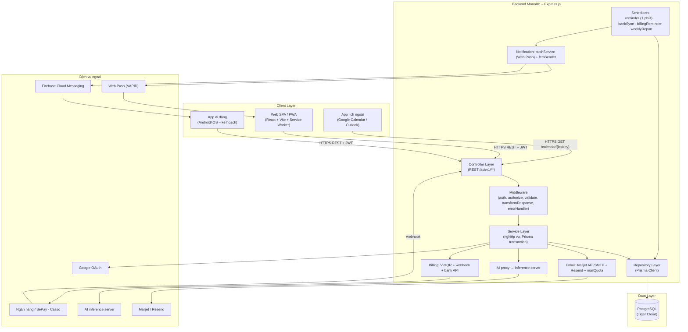
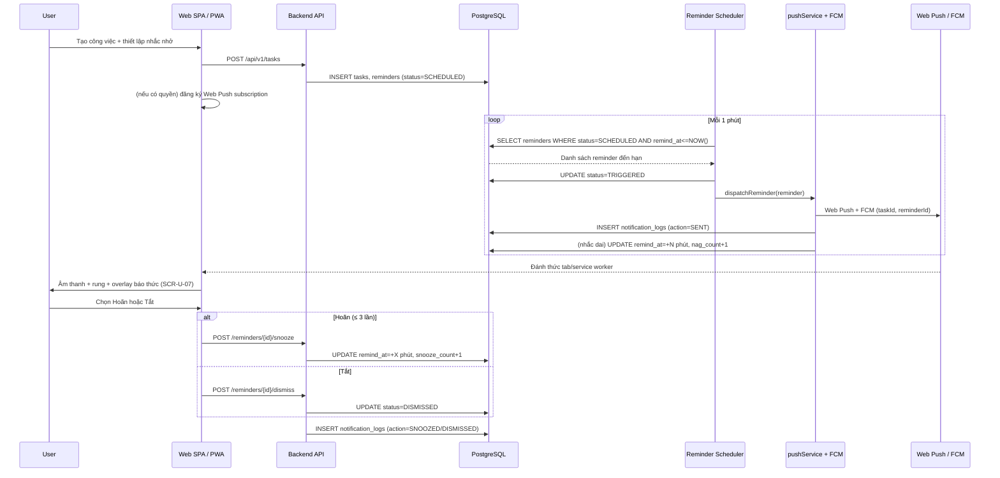
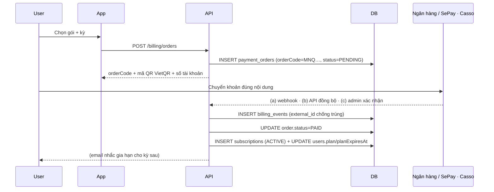
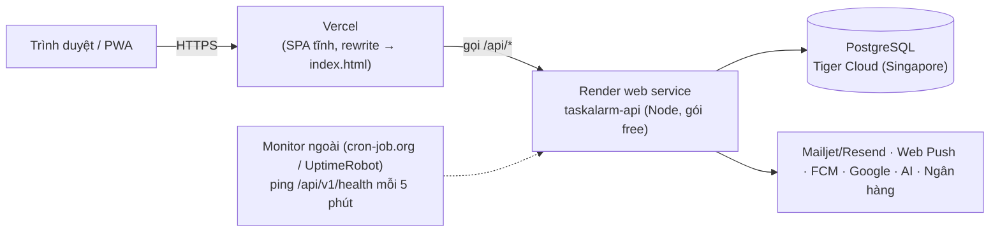

# Kiến trúc Hệ thống – MN-Qronx

> Tài liệu này thay thế `07_TaskAlarm_Architecture.md`.

## 1. Tổng quan

MN-Qronx là hệ thống **Monolithic Backend + Web SPA (PWA)**, dùng một REST API duy nhất; app di động dùng chung API đó. Kiến trúc giữ đơn giản (KISS/YAGNI), không microservice, không message queue. Điểm phức tạp nhất là **các scheduler** (báo thức đúng giờ, đồng bộ thanh toán, báo cáo tuần) và **cổng quyền lợi theo gói**.

| Thành phần | Công nghệ | Ghi chú |
|---|---|---|
| Backend API | Node.js 20+ · Express 5 · Prisma 6 (PostgreSQL) · jsonwebtoken + bcryptjs · express-validator 7 · node-cron 4 | 1 service monolith |
| Tích hợp backend | `web-push` (VAPID) · `firebase-admin` (FCM) · `nodemailer` (Mailjet SMTP/API + Resend) · `qrcode` · `swagger-jsdoc`/`swagger-ui-express` | Cổng gửi thông báo/email tập trung |
| Web Frontend | React 18 · Vite 5 · React Router DOM v6 · TailwindCSS 3 · Phosphor Icons · Context API | SPA + PWA (service worker, manifest) |
| App di động (kế hoạch) | Tái dùng lớp `services/` và luật validate | Kênh FCM đã sẵn ở backend |
| Database | PostgreSQL (Prisma) trên **Tiger Cloud** | Xem `04_MN-Qronx_database_design.md` |
| Trợ lý AI | Inference server riêng (thư mục `ai/`) | Model phân tích câu → công việc |
| Thanh toán | VietQR + webhook SePay/Casso + API ngân hàng (SePay/ACB) + Google Play (kế hoạch) | Trang quản trị cấu hình ngay trong app |
| Email | Mailjet (API ưu tiên, SMTP dự phòng) + Resend | Có kiểm tra hạn mức gửi |
| Triển khai | Backend: Render (web service gói free) · Frontend: Vercel | DB tách riêng ở Tiger Cloud |

## 2. Sơ đồ kiến trúc tổng thể



## 3. Kiến trúc Backend (layered)

Luồng `route → middleware → controller → service → repository → Prisma`.

```
backend/
├── src/
│   ├── app.js               # Express app: helmet, cors, json, routes, errorHandler, notFound
│   ├── server.js            # Entry: listen + khởi động scheduler + móc việc định kỳ theo /health
│   ├── config/              # index.js (đọc env), prisma.js, swagger.js
│   ├── middleware/          # auth, authorize, validate, transformResponse, errorHandler, notFound
│   ├── controllers/         # auth, user, category, task, subtask, reminder, taskShare, device,
│   │                        # dashboard, report, planner, admin, plan, billing, reward, ai,
│   │                        # support, family, calendarIcs, customSound
│   ├── services/            # business logic (billing, reward, family, taskShare, ai, aiQuota,
│   │                        # nag, reminder, reminderDispatch, push, email, mailQuota, report,
│   │                        # planner, support, calendarIcs, customSound, bankApi, googleAuth…)
│   ├── repositories/        # Prisma queries (task, category, reminder, device, user, admin…)
│   ├── dto/
│   │   ├── request/         # quy tắc validate (express-validator) theo module
│   │   └── response/        # apiResponse.js – envelope { success, message, data }
│   ├── routes/              # index.js mount tất cả sub-route + /health
│   ├── schedulers/          # reminderScheduler, bankSyncScheduler, billingReminderScheduler, weeklyReportScheduler
│   ├── notifications/       # fcmSender
│   ├── constants/           # enums.js
│   └── utils/               # planLimits, ApiError, catchAsync, dateUtils, pagination, tokenUtils, bankProviders
├── prisma/
│   ├── schema.prisma        # 27 model – nguồn sự thật của DB
│   └── seed.js              # roles + admin + dữ liệu demo
├── scripts/                 # db-dump, db-restore, mail:* (kiểm tra/ gửi thử email)
├── tests/                   # vitest (auth, tasks, billing, family, nag, planner, reports, support…)
├── Dockerfile, docker-compose.yml
└── .env.example
```

### 3.1. Cổng quyền lợi theo gói (`utils/planLimits.js`)

Đây là **nguồn duy nhất** về giá, hạn mức và quyền lợi của 4 gói. Mọi controller/service kiểm tra giới hạn qua đây (không chép tay danh sách ở nơi khác). Hàm chính:

- `getUserPlan(userId)` — gói hiệu lực (gói trả phí hết hạn tính như Miễn phí ngay).
- `planLimit(plan, key)`, `planAllows(plan, key)`, `planIsPro(plan)` — kiểm tra hạn mức/quyền.
- `planLimitError(...)` — ném lỗi `400` kèm chỉ dẫn nâng cấp.
- `planCatalog()`, `planPrice(plan, cycle)`, `cycleDays(cycle)` — dùng cho trang giá và app.
- `downgradeExpiredPlans()` — hạ gói hết hạn (gọi từ scheduler mỗi phút).

Gói `FAMILY` được **dựng từ `PRO`** (spread) nên quyền lợi/hạn mức không bao giờ lệch nhau.

### 3.2. Reminder Scheduler — thành phần trọng tâm

- `node-cron` biểu thức `*/1 * * * *` (mỗi **1 phút**) chạy trong cùng process backend.
- Mỗi lượt quét:
  1. Dọn thùng rác: xóa cứng việc đã `deletedAt` quá **30 ngày** (chạy tối đa 1 lần/ngày).
  2. `syncFamilySeats()` — đồng bộ quyền Pro của thành viên gia đình theo chủ gói (có chốt chặn trong tiến trình để cron và nhịp `/health` không chồng nhau).
  3. `downgradeExpiredPlans()` — hạ gói trả phí quá hạn.
  4. Truy vấn `reminders` có `status = 'SCHEDULED' AND remind_at <= now` (dùng chỉ mục `ix_reminders_status_remind_at`), kèm task + user + thiết bị hoạt động + người được giao chưa xong.
  5. Gọi `dispatchReminder()` cho từng reminder.
- `dispatchReminder()` (tách riêng để test được):
  1. Đánh dấu `TRIGGERED`.
  2. Soạn nội dung (nhắc lại lần N nếu là nhắc dai).
  3. `pushToUser()` — Web Push tới mọi subscription (chuông kêu kể cả khi đóng tab).
  4. FCM + ghi `NotificationLog` cho từng thiết bị.
  5. `nextNagPlan()` — nếu việc chưa xong, còn quyền Pro và chưa quá 10 lần thì đặt lại chính reminder đó kêu sau N phút.

### 3.3. Các scheduler khác

| Scheduler | Nhịp | Việc |
|---|---|---|
| `bankSyncScheduler` | theo `billing_settings.sync_interval_minutes` | Kéo giao dịch từ API ngân hàng, khớp mã đơn, kích hoạt gói. |
| `billingReminderScheduler` | mỗi phút (kiểm tra "đến kỳ") | Gửi email nhắc gia hạn trước khi gói hết hạn (mỗi kỳ 1 lần). |
| `weeklyReportScheduler` | `*/15 * * * *` | Gửi báo cáo tuần vào sáng thứ Hai (mỗi tuần 1 lần/tài khoản). |

### 3.4. Móc việc định kỳ theo nhịp `/health`

Web service gói free của Render **ngủ sau 15 phút**. Khi ngủ, cron không chạy. Vì vậy `/api/v1/health` (được dịch vụ keep-alive ping định kỳ) gọi thêm `runBankSyncIfDue()`, `runRenewalRemindersIfDue()` và `runWeeklyReportsIfDue()` — **không gắn móc thì `/health` vẫn chạy như cũ**.

## 4. Kiến trúc Frontend Web (React SPA + PWA)

```
src/
├── components/
│   ├── common/     # Button, Badge, Modal, Toast, Inputs, Avatar, Feedback, VoiceButton
│   ├── layout/     # AppShell, AdminShell, Sidebar, Header, BottomNav, NavItems, SupportBadge
│   ├── AlarmOverlay.jsx      # SCR-U-07 – báo thức toàn màn hình
│   ├── QuickCapture.jsx      # Tạo việc nhanh (kèm nút mic)
│   ├── AiTaskChat.jsx        # Khung chat trợ lý AI
│   └── UpdateNotification.jsx
├── pages/
│   ├── guest/   # Landing, Login, Register, Forgot/ResetPassword, Pricing, OAuthCallback
│   ├── user/    # Dashboard, TaskList, TaskDetail, TaskForm, Calendar, Categories,
│   │            # NotificationHistory, Settings, Profile, ChangePassword, Billing,
│   │            # AiAssistant, Rewards, Reports, Planner, Assigned, Family, Support
│   └── admin/   # AdminDashboard, AdminUsers, AdminOrders, AdminSupport
├── context/     # AuthContext, AlarmContext, ThemeContext, LanguageContext
├── services/    # apiClient (REST thật) + các service theo module (task, auth, billing…)
├── lib/         # db (demo), constants, format, push, aiCommand, chatHistory, dataEvents, useCachedQuery…
├── hooks/       # usePointerEffects
└── i18n/        # vi / en
```

- **`apiClient.js`** là client REST thật: gắn `Authorization: Bearer`, tự động gọi `/auth/refresh-token` khi gặp `401` rồi thử lại một lần; có `warmUpServer()` gọi `/health` ngay khi mở app để đánh thức máy chủ.
- **`AlarmContext`** lắng nghe sự kiện Web Push/Service Worker và kết quả polling reminder đến hạn để quyết định hiển thị overlay báo thức, độc lập với route hiện tại.
- **`ThemeContext`/`LanguageContext`** lo chế độ tối và song ngữ Việt/Anh.
- **PWA**: `public/sw.js` (hiện thông báo hệ thống, mở/focus đúng trang khi click, cache app shell, **không** cache API), `public/manifest.json` + icon 192/512/maskable; `useCachedQuery` hiển thị dữ liệu đã lưu và tự thử lại khi gặp 502/503.
- Menu và trang Pro hiển thị **khung nâng cấp** thay vì ẩn hoàn toàn với người dùng chưa có quyền.

## 5. Cổng gửi thông báo (Web Push + FCM)

- **Web Push**: `web-push` với khoá VAPID lấy từ biến môi trường, thiếu thì **tự sinh một lần và lưu vào `app_settings`** (giữ nguyên qua các lần khởi động lại). Mỗi người dùng tối đa 6 subscription; endpoint trả 404/410 bị xóa tự động.
- **FCM**: `firebase-admin` cho thiết bị `platform != WEB`.
- Cổng gửi **không quan tâm âm thanh cụ thể**; client tự lấy `alarmSound` từ cài đặt đã cache để phát đúng âm thanh, tránh round-trip khi báo thức cần phản ứng tức thời.

## 6. Luồng xử lý báo thức đầu-cuối (Sequence Diagram)



## 7. Luồng thanh toán (Sequence Diagram)



## 8. Bảo mật

- JWT stateless: access token ngắn hạn + refresh token lưu DB. Web lưu token trong `localStorage` (khóa `mnq:*`).
- Đổi mật khẩu/đăng xuất thu hồi refresh token; tài khoản bị khóa không đăng nhập được.
- Phân quyền theo vai trò qua middleware `authorize('ADMIN')`; mọi truy vấn dữ liệu đều khóa theo `userId` (ownership check).
- Webhook thanh toán xác thực bằng mã bí mật sinh từ trang quản trị; `billing_events.external_id` chống xử lý trùng.
- Khoá lịch `.ics`, `resetToken`, mã xác nhận webhook đều là bí mật có thể xoay.
- Email gửi từ tên miền riêng đã xác thực SPF/DKIM; hệ thống kiểm tra hạn mức gửi trước khi gửi.
- Web Push yêu cầu HTTPS; app di động dự kiến lưu token trong Secure Storage.

## 9. Triển khai (Deployment)



- **Backend**: Render; `buildCommand` = `npm install && npx prisma generate`; `startCommand` = `npx prisma db push --skip-generate && npm run seed && node src/server.js`; health check `/api/v1/health`.
- **Frontend**: Vercel (Vite), rewrite mọi đường dẫn về `/index.html`; biến `VITE_API_URL` trỏ tới backend.
- **Database**: Tiger Cloud (không còn do Render quản lý) — `DATABASE_URL` đặt trong dashboard.
- **Keep-alive**: máy chủ free ngủ sau 15 phút; monitor ngoài ping `/health` mỗi 5 phút vừa giữ máy chủ thức vừa đánh thức việc định kỳ. GitHub Actions cron **không** dùng vì hết hạn mức phút cho repo private.

## 10. Giới hạn kiến trúc (Non-goals)

- ❌ Không microservice; Notification/AI/Billing là module trong cùng monolith.
- ❌ Không message queue (Kafka/RabbitMQ); cron quét DB là đủ ở quy mô hiện tại.
- ❌ Không WebSocket hai chiều giữa các thiết bị; đồng bộ theo pull (client gọi lại API khi mở app hoặc sau khi nhận push).
- ❌ Không tự xây hạ tầng push/email riêng; dùng Web Push chuẩn, FCM, Mailjet/Resend.
- ❌ Không dùng AI cho tính năng lập kế hoạch (kế hoạch tuần làm bằng luật để không bịa việc).
- ❌ Không lưu file trên dịch vụ ngoài: ảnh hỗ trợ và âm thanh riêng lưu thẳng trong DB.
