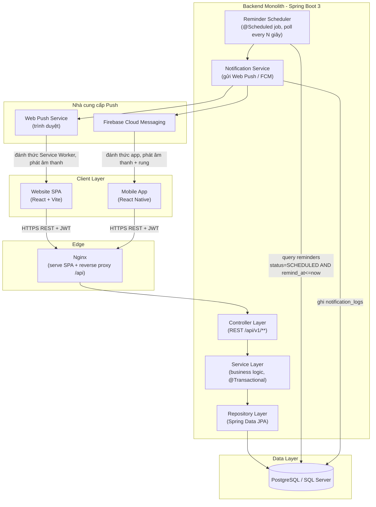
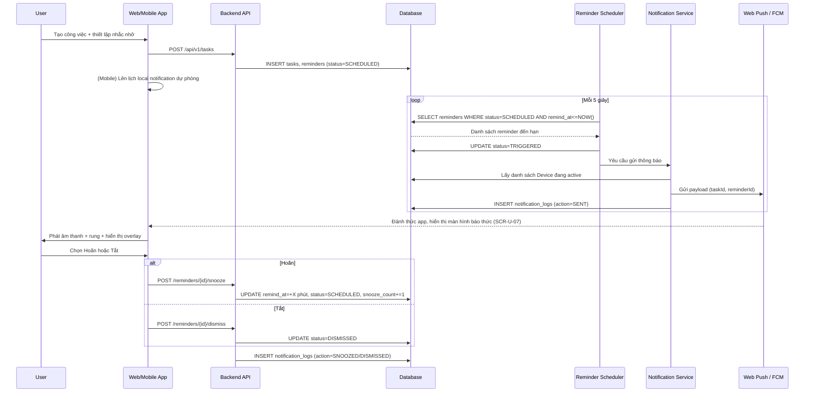
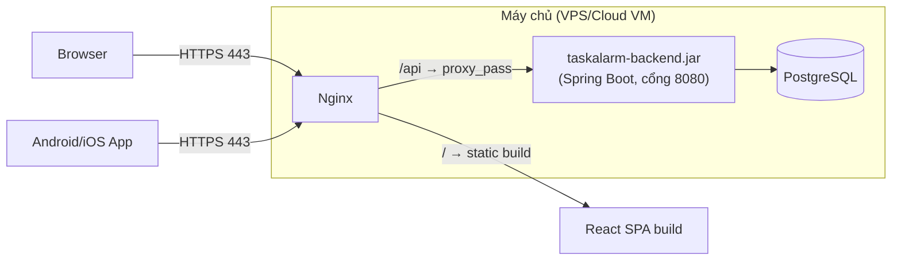

# Kiến trúc Hệ thống – TaskAlarm

## 1. Tổng quan

TaskAlarm là hệ thống **Monolithic Backend + Đa Client** (Website SPA và Mobile App) dùng chung một REST API duy nhất. Kiến trúc được giữ đơn giản (KISS/YAGNI), không tách Microservices, không Message Queue — điểm phức tạp duy nhất cần xử lý cẩn thận là **Reminder Scheduler**, thành phần chịu trách nhiệm kích hoạt báo thức đúng giờ và đẩy thông báo tới đúng thiết bị.

| Thành phần | Công nghệ | Ghi chú |
|---|---|---|
| Backend API | Java 17/21, Spring Boot 3.x, Spring Data JPA, Spring Security (JWT), Spring Scheduler | 1 service monolith duy nhất |
| Web Frontend | React 18+ (Vite), React Router DOM v6, Axios, TailwindCSS, Context API | SPA, cùng team với Mobile để tái dùng service layer |
| Mobile App | React Native (Expo) | Dùng chung ngôn ngữ/JS với Web, tái dùng phần lớn logic gọi API và validate |
| Database | PostgreSQL 15+ / SQL Server 2019+ | Chọn 1 trong 2, không chạy song song |
| Push Notification | Web Push (VAPID) cho trình duyệt; Firebase Cloud Messaging (FCM) cho Android/iOS | Một cổng gửi thống nhất ở tầng Notification Service |
| Local Alarm (Mobile) | Notifee / Expo Notifications (local scheduled notification) | Dự phòng khi mất mạng, đảm bảo NFR-08 |
| Reverse Proxy | Nginx | Phục vụ Web SPA tĩnh + proxy `/api` tới Backend |

## 2. Sơ đồ kiến trúc tổng thể



## 3. Kiến trúc Backend (Spring Boot 3-Tier)

Tuân thủ `backend_rules.md`: chỉ 4 tầng `controller → service → repository → entity`, không DDD/CQRS/Event Sourcing.

```
com.taskalarm
├── controller/        # Nhận request, @Valid, trả ResponseEntity<ApiResponse<T>>
├── service/
│   └── impl/           # Business logic, @Transactional
├── repository/         # JpaRepository<Entity, Long>
├── entity/             # JPA Entity (Task, Reminder, Category, Device...)
├── dto/
│   ├── request/
│   └── response/
├── scheduler/          # ReminderScheduler (@Scheduled)
├── notification/       # NotificationService, WebPushSender, FcmSender
├── security/           # JWT filter, Spring Security config
└── exception/          # GlobalExceptionHandler, Custom Exceptions
```

### 3.1. Reminder Scheduler — thành phần trọng tâm

- Chạy bằng `@Scheduled(fixedDelay = 5000)` (poll mỗi 5 giây) trong cùng process Backend — **không cần** hạ tầng message queue riêng, phù hợp quy mô đồ án và nguyên tắc YAGNI.
- Mỗi lượt quét: `SELECT ... FROM reminders WHERE status = 'SCHEDULED' AND remind_at <= NOW()` (tận dụng index `ix_reminders_status_remind_at` đã tạo ở schema), khóa các dòng đủ điều kiện, chuyển `status = 'TRIGGERED'` trong transaction ngắn để tránh gửi trùng nếu có nhiều instance backend (khi scale ngang, cần thêm khóa dòng `SELECT ... FOR UPDATE SKIP LOCKED` — ghi chú dự phòng, không bắt buộc ở giai đoạn 1 instance).
- Sau khi đánh dấu `TRIGGERED`, gọi `NotificationService` để gửi tới toàn bộ `Device` đang `is_active = true` của User sở hữu Task, đồng thời ghi `notification_logs` (`action = SENT`).
- Khi User gọi API `snooze`/`dismiss` (mục 7 trong `05_TaskAlarm_API_Specification.md`), Service cập nhật lại `reminders.status` và ghi log tương ứng — Scheduler không cần biết về hành động này, chỉ quét các reminder còn `SCHEDULED`.

### 3.2. Notification Service — cổng gửi thống nhất

- Nhận vào 1 Reminder đã `TRIGGERED` + danh sách Device của User.
- Với `platform = WEB`: gửi qua Web Push (VAPID keys), payload gồm `title`, `body`, `taskId`, `reminderId` để Service Worker mở đúng màn hình báo thức khi User click.
- Với `platform = ANDROID`/`IOS`: gửi qua FCM, payload đánh dấu `priority: high` để hệ điều hành đánh thức app hiển thị full-screen alarm ngay cả khi đang khóa máy/ở nền.
- Notification Service không quan tâm nội dung âm thanh cụ thể — chỉ gửi định danh Task/Reminder; Client (Web/Mobile) tự lấy `alarmSound` từ `notification-settings` đã cache cục bộ để phát đúng âm thanh User đã chọn, tránh round-trip thêm khi báo thức cần phản ứng tức thời.

## 4. Kiến trúc Frontend Web (React SPA)

Tuân thủ `frontend_rules.md`: Context API (không Redux), mọi API call qua `services/`, không gọi axios trực tiếp trong component.

```
src/
├── components/
│   ├── common/        # Button, Badge, Modal, Spinner...
│   └── layout/         # Sidebar, Header, BottomNav (mobile web)
├── pages/               # DashboardPage, TaskListPage, TaskDetailPage, CalendarPage...
├── services/            # authApi.js, taskApi.js, reminderApi.js, deviceApi.js...
├── context/
│   ├── AuthContext.jsx
│   └── AlarmContext.jsx   # Lắng nghe Web Push / Service Worker message, điều khiển overlay báo thức toàn cục
├── serviceWorker/        # Đăng ký Web Push, nhận push event, phát âm thanh khi tab đóng
└── routes/                # ProtectedRoute theo vai trò
```

- **`AlarmContext`** là thành phần đặc thù của TaskAlarm (không có ở kiến trúc thương mại điện tử thông thường): lắng nghe sự kiện từ Service Worker (`postMessage`) hoặc kết quả gọi `GET /api/v1/reminders/due` khi ứng dụng vừa mở lại, từ đó quyết định có hiển thị overlay báo thức toàn màn hình (SCR-U-07) hay không, độc lập với route hiện tại của React Router.

## 5. Kiến trúc Mobile App (React Native)

- Tái sử dụng tối đa lớp `services/` (gọi API) và các quy tắc validate với Web để giảm sai lệch nghiệp vụ giữa hai nền tảng — tuân thủ nguyên tắc DRY ở mức toàn dự án.
- State management: Context API tương tự Web, giữ nhất quán quy ước `frontend_rules.md`.
- **Local Notification dự phòng**: ngay khi tạo/sửa Reminder thành công qua API, Mobile App đồng thời lên lịch một local notification (Notifee/Expo Notifications) trùng thời điểm `remindAt` ngay trên thiết bị. Đây là lớp dự phòng độc lập với FCM để đảm bảo báo thức vẫn kêu khi mất kết nối mạng tạm thời (NFR-08); khi app mở lại và đồng bộ thành công, local notification trùng với reminder đã `DISMISSED`/`CANCELLED` từ server sẽ bị hủy để tránh báo hai lần.
- **Full-screen Alarm**: dùng Full-Screen Intent (Android) / Critical Alert hoặc Time-Sensitive Notification (iOS, cần cấu hình entitlement riêng) để mở thẳng màn hình báo thức (SCR-U-07) kể cả khi máy đang khóa.

## 6. Luồng xử lý báo thức đầu-cuối (Sequence Diagram)



## 7. Bảo mật

- Stateless JWT (Spring Security 6), token gửi qua header `Authorization: Bearer` từ cả Web và Mobile — không dùng session/cookie để tránh phức tạp CORS/CSRF không cần thiết.
- Web lưu token trong `localStorage` (đúng `frontend_rules.md`); Mobile lưu trong Secure Storage của hệ điều hành (Keychain/EncryptedSharedPreferences) — an toàn hơn AsyncStorage thường.
- `device_token` (Web Push subscription / FCM token) được coi là dữ liệu nhạy cảm, chỉ gắn được với đúng `user_id` đang đăng nhập (ERD-R-16), không expose qua bất kỳ API công khai nào.
- Toàn bộ giao tiếp Client–Backend qua HTTPS bắt buộc, kể cả môi trường phát triển nội bộ khi test Push Notification (Web Push và FCM đều yêu cầu HTTPS).

## 8. Kiến trúc triển khai (Deployment)



- Web SPA build (`vite build`) được deploy dưới dạng static file, phục vụ qua Nginx cùng server với Backend để đơn giản hóa hạ tầng (đúng quy mô đồ án, không cần CDN riêng).
- Backend đóng gói thành 1 file `.jar` duy nhất (`Monolith`), chạy bằng `systemd` service hoặc container Docker đơn (không Kubernetes/Docker Swarm ở giai đoạn này).
- Mobile App build riêng theo pipeline Expo/EAS Build, phân phối qua Google Play/TestFlight hoặc APK trực tiếp cho mục đích trình diễn đồ án.

## 9. Giới hạn kiến trúc (Non-goals)

Nhất quán với `project_context.md`-style của dự án và mục 1.4 trong BA:

- ❌ Không Microservices, không tách Notification Service thành service độc lập ở giai đoạn 1 — vẫn nằm trong cùng monolith, chỉ tách rõ package.
- ❌ Không dùng Message Queue (Kafka/RabbitMQ) cho việc gửi thông báo; `@Scheduled` polling trong DB là đủ ở quy mô người dùng của đồ án.
- ❌ Không đồng bộ real-time hai chiều qua WebSocket giữa các thiết bị — đồng bộ dữ liệu dựa trên việc Client tự gọi lại API sau khi nhận Push hoặc khi mở lại app (pull-based), giữ kiến trúc đơn giản.
- ❌ Không tự build hạ tầng Push riêng — tận dụng Web Push chuẩn của trình duyệt và Firebase Cloud Messaging thay vì tự triển khai APNs/FCM gateway riêng.
